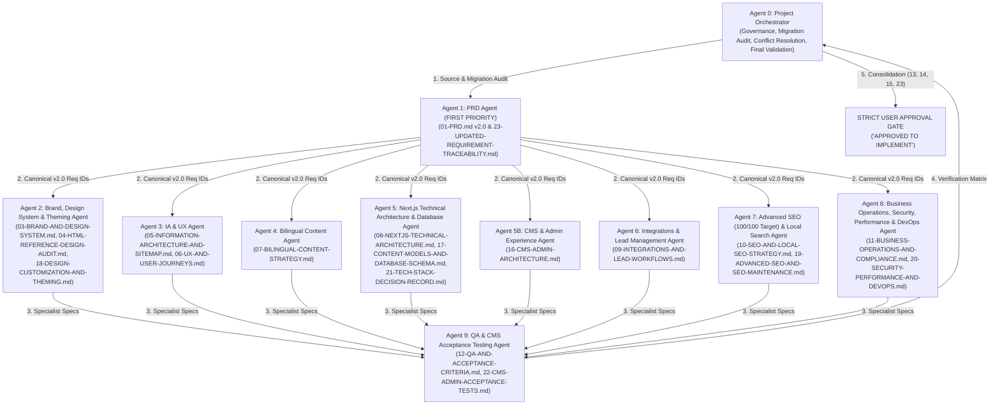

# 02 — Multi-Agent Architecture & Governance Model (v2.0 — Next.js & Payload CMS)

**Project:** Bayyora (بيّورا) — Master Project Discovery, Next.js Architecture Migration & Full CMS Planning  
**Owner:** Agent 0 (Project Orchestrator)  
**Date:** 8 November 2026  
**Execution Mode:** Planning-Only (Strict Approval Gate Enforced)

---

## 1. Multi-Agent Orchestration Overview

Following the Owner's mandatory technology directive migrating Bayyora from WordPress to **Next.js (App Router) + TypeScript (Strict) + Tailwind CSS + Integrated Payload CMS 3.x + PostgreSQL**, the specialist agent architecture has been expanded and reassigned to cover all 24 planning deliverables (`00` through `23`).

---

## 2. Specialist Agent Roster, Reassigned Responsibilities & Deliverables

| Agent ID | Specialist Role | Core Responsibilities (v2.0 Next.js Migration) | Owned Planning Deliverables | Hard Boundaries (Prohibited Actions) |
| :--- | :--- | :--- | :--- | :--- |
| **Agent 0** | **Project Orchestrator** | • Enforce the Owner's mandatory Next.js + Payload CMS + TypeScript + Tailwind directive. • Retire the obsolete WordPress architecture document (`08-WORDPRESS-TECHNICAL-ARCHITECTURE.md` replaced by `08-NEXTJS-TECHNICAL-ARCHITECTURE.md`). • Ensure 100% cross-document consistency across all 24 planning files (`00`–`23`). • Enforce the strict `"APPROVED TO IMPLEMENT"` gate. | • `00-PROJECT-SOURCE-AUDIT.md` • `02-AGENT-ARCHITECTURE.md` • `13-IMPLEMENTATION-ROADMAP.md` • `14-OPEN-DECISIONS-AND-RISK-REGISTER.md` • `15-APPROVAL-CHECKLIST.md` • `23-UPDATED-REQUIREMENT-TRACEABILITY.md` | Must never authorize implementation without the user's explicit `"APPROVED TO IMPLEMENT"` command. |
| **Agent 1** | **PRD Agent (First Priority)** | • Update `01-PRD.md` with Next.js App Router, Payload CMS-driven customization (`CMS-001`–`CMS-011`), 100/100 Lighthouse SEO target, and 90+ Mobile Performance target. • Co-maintain full requirement traceability (`23`). | • `01-PRD.md` • `23-UPDATED-REQUIREMENT-TRACEABILITY.md` | Must not invent features, public prices, or unverified metrics. |
| **Agent 2** | **Brand, Design System & Theming Agent** | • Define Tailwind CSS design tokens and CSS custom properties. • Design the CMS-managed `ThemeSettings` global (`18-DESIGN-CUSTOMIZATION-AND-THEMING.md`) with WCAG AA contrast guardrails. • Maintain the 17-point HTML reference audit (`04`). | • `03-BRAND-AND-DESIGN-SYSTEM.md` • `04-HTML-REFERENCE-DESIGN-AUDIT.md` • `18-DESIGN-CUSTOMIZATION-AND-THEMING.md` | Must not treat proposed colors as final approved assets; must not allow unrestricted arbitrary CSS injection that breaks brand integrity. |
| **Agent 3** | **Information Architecture & UX Agent** | • Map all 27 bilingual routes (54 pages) to Next.js App Router `[locale]` dynamic segments and CMS collections. • Specify the 15-block page builder UX and interactive client islands. | • `05-INFORMATION-ARCHITECTURE-AND-SITEMAP.md` • `06-UX-AND-USER-JOURNEYS.md` | Must not drop any of the 9 services, 5 cities, or 3 legal pages. |
| **Agent 4** | **Bilingual Content Agent** | • Map all Arabic and English copy into Payload CMS localized fields (`ar` default, `en` secondary). • Specify translation completeness tracking, missing translation warnings, and `نموذج توضيحي / Sample concept` badge automation. | • `07-BILINGUAL-CONTENT-STRATEGY.md` | Must never invent testimonials, statistics, client logos, contact details, or prices. |
| **Agent 5** | **Next.js Technical & Database Architecture Agent** | • Replace WordPress architecture completely with Next.js App Router + TypeScript (Strict) + Tailwind CSS + Server Components. • Compare PostgreSQL vs. MongoDB across all 8 required criteria and document the selection of **PostgreSQL**. • Design all 11 Payload Collections and 4 Globals (`17`). • Evaluate all supporting libraries (`21`). | • `08-NEXTJS-TECHNICAL-ARCHITECTURE.md` • `17-CONTENT-MODELS-AND-DATABASE-SCHEMA.md` • `21-TECH-STACK-DECISION-RECORD.md` | Must not scaffold Next.js code, install npm packages, or provision databases prior to approval. |
| **Agent 5B** | **CMS & Admin Experience Agent** | • Design the complete Payload Admin Dashboard experience: 6 RBAC roles, Global Settings, Header/Footer editors, 15-block page builder, Media library with reference protection, Live Preview, Versioning, Rollback, and On-Demand Cache Revalidation. | • `16-CMS-ADMIN-ARCHITECTURE.md` | Must not hardcode business content inside React components. |
| **Agent 6** | **Integrations & Lead Management Agent** | • Design the server-side TypeScript integration abstraction layer (`CRMProvider`) using Next.js Server Actions and Zod validation for GoHighLevel Forms, Calendar, WhatsApp deep links, and consent-aware GTM/GA4/Meta/Snapchat pixels. | • `09-INTEGRATIONS-AND-LEAD-WORKFLOWS.md` | Must never expose private API keys in `NEXT_PUBLIC_*` client variables or connect live accounts during planning. |
| **Agent 7** | **Advanced SEO & Local Search Agent** | • Architect the **100/100 Lighthouse SEO** system using Next.js `generateMetadata`, dynamic `sitemap.ts`, `robots.ts`, canonicals, `hreflang`, truthful JSON-LD structured data, and built-in CMS SEO Admin Tools (character counters, missing alt/translation warnings, 301 redirect manager). | • `10-SEO-AND-LOCAL-SEO-STRATEGY.md` • `19-ADVANCED-SEO-AND-SEO-MAINTENANCE.md` | Must never invent ratings, reviews, prices, addresses, or search volume forecasts. |
| **Agent 8** | **Operations, Security, Performance & DevOps Agent** | • Maintain business SOPs & Saudi compliance (PDPL, SFDA, Mawthooq) (`11`). • Architect authentication, 6-role RBAC enforcement, rate limiting, file upload sanitization, ISR/tag cache revalidation, CI/CD pipelines, PostgreSQL PITR backups, and disaster recovery (`20`). | • `11-BUSINESS-OPERATIONS-AND-COMPLIANCE.md` • `20-SECURITY-PERFORMANCE-AND-DEVOPS.md` | Must not deploy infrastructure or invent legal/payment terms. |
| **Agent 9** | **QA & Acceptance Criteria Agent** | • Define public website QA criteria (Vitest, Playwright, axe-core, Lighthouse CI 90+/95+/95+/100) (`12`). • Define comprehensive CMS Admin acceptance test suites covering every collection, role, workflow, and cache revalidation (`22`). | • `12-QA-AND-ACCEPTANCE-CRITERIA.md` • `22-CMS-ADMIN-ACCEPTANCE-TESTS.md` | Must not execute implementation tests during planning mode. |

---

## 3. Architecture Migration Log (WordPress Retired → Next.js + Payload CMS Adopted)

| Decision ID | Previous Planning Baseline (v1.0) | New Owner-Mandated Architecture (v2.0) | Impacted Documents |
| :--- | :--- | :--- | :--- |
| **MIG-01** | WordPress 6.x + PHP 8.2 custom hybrid theme (`bayyora-theme`) | **Next.js (App Router) + React + TypeScript (Strict) + Tailwind CSS** with React Server Components by default | `08-WORDPRESS-TECHNICAL-ARCHITECTURE.md` **RETIRED & DELETED**; replaced by `08-NEXTJS-TECHNICAL-ARCHITECTURE.md` and `21-TECH-STACK-DECISION-RECORD.md` |
| **MIG-02** | WordPress Admin + ACF Pro + Polylang Pro + Rank Math + WP Rocket | **Payload CMS 3.x (Integrated Self-Hosted inside Next.js)** with native field-level localization (`ar`/`en`), built-in SEO plugin/tools, and Next.js `revalidateTag`/`revalidatePath` caching | `16-CMS-ADMIN-ARCHITECTURE.md`, `17-CONTENT-MODELS-AND-DATABASE-SCHEMA.md`, `19-ADVANCED-SEO-AND-SEO-MAINTENANCE.md` |
| **MIG-03** | MySQL / MariaDB (`wp_posts` / `wp_postmeta`) | **PostgreSQL** with relational foreign keys, localized tables (`*_locales`), and version-controlled Drizzle SQL migrations | `17-CONTENT-MODELS-AND-DATABASE-SCHEMA.md`, `20-SECURITY-PERFORMANCE-AND-DEVOPS.md`, `21-TECH-STACK-DECISION-RECORD.md` |
| **MIG-04** | Mobile PageSpeed target `80+` | **Mobile Lighthouse Performance `90+`, Accessibility `95+`, Best Practices `95+`, Lighthouse SEO `100/100`** | `01-PRD.md`, `12-QA-AND-ACCEPTANCE-CRITERIA.md`, `19-ADVANCED-SEO-AND-SEO-MAINTENANCE.md`, `20-SECURITY-PERFORMANCE-AND-DEVOPS.md` |
| **MIG-05** | Static PHP template files with partial ACF fields | **100% CMS-Driven Architecture:** Global Settings, Header/Footer, 15-Block Page Builder, Services, Packages, Portfolio, Cities, Blog, FAQs, Media, and Design Tokens all editable via Admin Dashboard | `16-CMS-ADMIN-ARCHITECTURE.md`, `17-CONTENT-MODELS-AND-DATABASE-SCHEMA.md`, `18-DESIGN-CUSTOMIZATION-AND-THEMING.md`, `22-CMS-ADMIN-ACCEPTANCE-TESTS.md` |
