# 05 — Information Architecture & Complete Sitemap

**Project:** Bayyora (بيّورا)  
**Author:** Agent 3 (Information Architecture & UX Agent)  
**Inputs:** `Doc A` (§2, §3), `01-PRD.md`, `03-BRAND-AND-DESIGN-SYSTEM.md`  
**Status:** Complete & Verified Against All 27 Source Routes (54 Bilingual Pages)

---

## 1. Site Hierarchy Overview

Bayyora's information architecture is flat, thumb-friendly, and conversion-oriented. Every page is at most **2 clicks** from the homepage and at most **1 click** from a primary conversion action (WhatsApp chat, Free Mini Audit, or Shop Visit booking).

```mermaid
flowchart TD
    ROOT["Home<br/>AR: /  |  EN: /en/<br/>(Phase 1)"]
    
    SVC["Services Hub<br/>/services/  |  /en/services/<br/>(Phase 2)"]
    PKG["Packages<br/>/packages/  |  /en/packages/<br/>(Phase 1 Preview / Phase 2 Full)"]
    WRK["Our Work<br/>/our-work/  |  /en/our-work/<br/>(Phase 2)"]
    ABT["About<br/>/about/  |  /en/about/<br/>(Phase 2)"]
    AUD["Free Mini Audit<br/>/free-audit/  |  /en/free-audit/<br/>(Phase 1)"]
    CNT["Contact / Book a Visit<br/>/contact/  |  /en/contact/<br/>(Phase 2)"]
    FAQ["FAQ<br/>/faq/  |  /en/faq/<br/>(Phase 2)"]
    BLG["Blog<br/>/blog/  |  /en/blog/<br/>(Phase 3)"]
    
    S1["1. Brand & Identity<br/>/services/brand-identity/"]
    S2["2. Print & Shop Design<br/>/services/print-shop-design/"]
    S3["3. Websites & Online Stores<br/>/services/websites-online-stores/"]
    S4["4. Social Media Management<br/>/services/social-media/"]
    S5["5. Video & Animation<br/>/services/video-animation/"]
    S6["6. Photography<br/>/services/photography/"]
    S7["7. Ads & Local Search<br/>/services/ads-local-search/"]
    S8["8. WhatsApp & Follow-up<br/>/services/whatsapp-follow-up/"]
    S9["9. Seasonal Campaigns<br/>/services/seasonal-campaigns/"]
    
    CS1["Case Study: Dawair (With Permission)<br/>/our-work/dawair/ (Phase 3)"]
    
    C1["Al Ahsa: /city/al-ahsa/ (Phase 3)"]
    C2["Hofuf: /city/hofuf/ (Phase 3)"]
    C3["Mubarraz: /city/mubarraz/ (Phase 3)"]
    C4["Dammam: /city/dammam/ (Phase 3)"]
    C5["Khobar: /city/khobar/ (Phase 3)"]
    
    L1["Privacy Policy: /privacy/ (Phase 2)"]
    L2["Terms of Service: /terms/ (Phase 2)"]
    L3["Refund & Revision Policy: /refunds/ (Phase 2)"]
    
    ROOT --> SVC & PKG & WRK & ABT & AUD & CNT & FAQ & BLG
    SVC --> S1 & S2 & S3 & S4 & S5 & S6 & S7 & S8 & S9
    WRK --> CS1
    ROOT --> C1 & C2 & C3 & C4 & C5
    ROOT --> L1 & L2 & L3
```

---

## 2. Master Bilingual Sitemap & Route Registry

> **URL Slug Rule (`Doc A` §2 — `[CONFIRMED]`):** Clean Latin URL slugs are used in both Arabic and English so URLs remain short and readable when pasted into WhatsApp (rather than percent-encoded Arabic characters). Arabic keywords are placed in `<title>`, `<h1>`, `<h2>`, body copy, and image `alt` attributes. Every route outputs bidirectional `hreflang="ar-SA"` and `hreflang="en"` tags.

| # | Page Name (EN / AR) | Arabic Root URL (`ar-SA`, `dir="rtl"`) | English URL (`en`, `dir="ltr"`) | Template ID | Rollout Phase | Primary Conversion Goal |
| :--- | :--- | :--- | :--- | :--- | :--- | :--- |
| **1** | **Home** / الرئيسية | `/` | `/en/` | `TPL-HOME` | **Phase 1** | WhatsApp Chat / Free Mini Audit |
| **2** | **Services Hub** / خدماتنا | `/services/` | `/en/services/` | `TPL-SVC-HUB` | **Phase 2** | Service Discovery → Free Mini Audit |
| **3** | **Brand and identity** / الهوية والشعار | `/services/brand-identity/` | `/en/services/brand-identity/` | `TPL-SVC-SINGLE` | **Phase 2** | WhatsApp (`أبغى شعار لمحلّي`) / Quote |
| **4** | **Print and shop design** / تصميم المطبوعات وواجهة المحل | `/services/print-shop-design/` | `/en/services/print-shop-design/` | `TPL-SVC-SINGLE` | **Phase 2** | WhatsApp (`أبغى أجدد لوحة محلي`) / Quote |
| **5** | **Websites and online stores** / المواقع والمتاجر الإلكترونية | `/services/websites-online-stores/` | `/en/services/websites-online-stores/` | `TPL-SVC-SINGLE` | **Phase 2** | WhatsApp (`أبغى موقع أو متجر لمحلّي`) |
| **6** | **Social media management** / إدارة السوشال ميديا | `/services/social-media/` | `/en/services/social-media/` | `TPL-SVC-SINGLE` | **Phase 2** | WhatsApp (`أبغى أحد يدير حساباتي`) |
| **7** | **Video and animation** / الفيديو والموشن | `/services/video-animation/` | `/en/services/video-animation/` | `TPL-SVC-SINGLE` | **Phase 2** | WhatsApp (`أبغى فيديو لمحلّي`) |
| **8** | **Photography** / التصوير | `/services/photography/` | `/en/services/photography/` | `TPL-SVC-SINGLE` | **Phase 2** | WhatsApp (`أبغى جلسة تصوير`) |
| **9** | **Ads and local search** / الإعلانات والظهور المحلي | `/services/ads-local-search/` | `/en/services/ads-local-search/` | `TPL-SVC-SINGLE` | **Phase 2** | WhatsApp (`أبغى أظهر أول في الخريطة`) |
| **10** | **WhatsApp and follow-up** / واتساب والمتابعة | `/services/whatsapp-follow-up/` | `/en/services/whatsapp-follow-up/` | `TPL-SVC-SINGLE` | **Phase 2** | WhatsApp (`أبغى أرتّب واتساب محلّي`) |
| **11** | **Seasonal campaigns** / الحملات الموسمية | `/services/seasonal-campaigns/` | `/en/seasonal-campaigns/` *(Note: `/en/services/seasonal-campaigns/`)* | `TPL-SVC-SINGLE` | **Phase 2** | WhatsApp (`أبغى أجهّز محلّي للموسم`) |
| **12** | **Packages** / الباقات | `/packages/` | `/en/packages/` | `TPL-PACKAGES` | **Phase 1** (Preview) **Phase 2** (Full) | Request a Quote / Free Mini Audit |
| **13** | **Our work** / أعمالنا | `/our-work/` | `/en/our-work/` | `TPL-WORK-HUB` | **Phase 2** | Free Mini Audit (`تبغى محلّك يكون القصة الجاية؟`) |
| **14** | **Case study: Dawair** / دراسة حالة: دوائر | `/our-work/dawair/` | `/en/our-work/dawair/` | `TPL-CASE-STUDY` | **Phase 3** *(Gated by OD-008)* | Free Mini Audit / WhatsApp |
| **15** | **About** / من نحن | `/about/` | `/en/about/` | `TPL-ABOUT` | **Phase 2** | Book a Shop Visit (`/contact/`) |
| **16** | **Free mini audit** / تحليل مجاني | `/free-audit/` | `/en/free-audit/` | `TPL-AUDIT` | **Phase 1** | Submit GHL Free Audit Form |
| **17** | **Contact / Book a visit** / تواصل معنا | `/contact/` | `/en/contact/` | `TPL-CONTACT` | **Phase 2** | WhatsApp / GHL Calendar Visit Booking |
| **18** | **City: Al Ahsa** / الأحساء | `/city/al-ahsa/` | `/en/city/al-ahsa/` | `TPL-CITY` | **Phase 3** | Book a Visit / WhatsApp |
| **19** | **City: Hofuf** / الهفوف | `/city/hofuf/` | `/en/city/hofuf/` | `TPL-CITY` | **Phase 3** | Book a Visit |
| **20** | **City: Mubarraz** / المبرّز | `/city/mubarraz/` | `/en/city/mubarraz/` | `TPL-CITY` | **Phase 3** | Free Mini Audit |
| **21** | **City: Dammam** / الدمام | `/city/dammam/` | `/en/city/dammam/` | `TPL-CITY` | **Phase 3** | WhatsApp |
| **22** | **City: Khobar** / الخبر | `/city/khobar/` | `/en/city/khobar/` | `TPL-CITY` | **Phase 3** | Free Mini Audit |
| **23** | **FAQ** / الأسئلة الشائعة | `/faq/` | `/en/faq/` | `TPL-FAQ` | **Phase 2** | WhatsApp Fallback CTA |
| **24** | **Blog** / المدونة | `/blog/` | `/en/blog/` | `TPL-BLOG` | **Phase 3** | Free Mini Audit / Service Discovery |
| **25** | **Privacy policy** / سياسة الخصوصية | `/privacy/` | `/en/privacy/` | `TPL-LEGAL` | **Phase 2** | Informational / PDPL Compliance |
| **26** | **Terms of service** / الشروط والأحكام | `/terms/` | `/en/terms/` | `TPL-LEGAL` | **Phase 2** | Informational / Commercial Terms |
| **27** | **Refund & revision policy** / سياسة الاسترجاع والتعديلات | `/refunds/` | `/en/refunds/` | `TPL-LEGAL` | **Phase 2** | Informational / Service Assurance |

*(Note on #11: Both `/services/seasonal-campaigns/` and `/en/services/seasonal-campaigns/` follow the exact `/services/` parent structure documented in `Doc A` §2 Sitemap table.)*

---

## 3. Navigation Architecture

### 3.1 Primary Header Navigation (`[CONFIRMED]`)
- **Top-Level Menu Items (6):**
  1. `الرئيسية` / `Home` → `/` (`/` or `/en/`)
  2. `خدماتنا` / `Services` → `/services/` (with accessible hover/click dropdown containing all 9 services in exact sitemap order `#3`–`#11`)
  3. `الباقات` / `Packages` → `/packages/`
  4. `أعمالنا` / `Our work` → `/our-work/`
  5. `من نحن` / `About` → `/about/`
  6. `تواصل معنا` / `Contact` → `/contact/`
- **Persistent Utility & Conversion Controls (Always Visible on Desktop & Mobile):**
  - **Language Switcher (`EN / عربي`):** Switches between the current Arabic page and its exact `/en/` counterpart.
  - **Primary Header CTA:** Saffron Rise button `اطلب تحليل مجاني` / `Free mini audit` → `/free-audit/`.

### 3.2 Global Footer Architecture (`[CONFIRMED]`)
Background: `Najd Night (#12233F)` with reversed Rising Line logo and tagline `خطوة لفوق / One step up`.
- **Column 1 — Services (`خدماتنا` / `Services`):** Links to all 9 individual service pages (`#3`–`#11`).
- **Column 2 — Bayyora (`بيّورا` / `Bayyora`):** Links to `About` (`/about/`), `Our work` (`/our-work/`), `Packages` (`/packages/`), `FAQ` (`/faq/`), and `Blog` (`/blog/`).
- **Column 3 — Areas We Serve (`مناطق خدمتنا` / `Areas we serve`):** Links to `Al Ahsa` (`/city/al-ahsa/`), `Hofuf` (`/city/hofuf/`), `Mubarraz` (`/city/mubarraz/`), `Dammam` (`/city/dammam/`), and `Khobar` (`/city/khobar/`).
- **Column 4 — Contact (`تواصل معنا` / `Contact`):** WhatsApp click-to-chat link, Phone number (`OD-011`), Business email (`OD-011`), Working hours (`الأحد إلى الخميس / Sunday–Thursday`, exact hours `OD-011`), plus Social Media icon links (**Snapchat, Instagram, TikTok, X**).
- **Bottom Legal Bar:** `© Bayyora · بيّورا` + links to `Privacy` (`/privacy/`), `Terms` (`/terms/`), and `Refunds` (`/refunds/`).

---

## 4. Page-Level Section Blueprints (Templates `TPL-*`)

### 4.1 `TPL-HOME` — Homepage (`/` & `/en/`)
1. **Hero Section:** H1 (`خطوة لفوق` / `One step up`), subline explaining `بيّن` meaning, dual CTAs (`راسلنا واتساب` + `اطلب تحليل مجاني`), and side-by-side Before→After visual with the Rising Line.
2. **Services Grid Section:** H2 (`كل اللي يحتاجه محلّك عشان يبان ويبيع أكثر`), intro paragraph, 9 service cards with exact benefit lines, and CTA (`شوف كل الخدمات` → `/services/`).
3. **Before & After Proof Section:** H2 (`قبل… وبعد`), body copy, Dawair Hofuf restaurant slot (coming soon, with client permission) + local shop sample concepts (`نموذج توضيحي` / `Sample concept`), and CTA (`شوف أعمالنا` → `/our-work/`).
4. **Packages Overview Section:** H2 (`باقات واضحة… وعرض سعر يناسب محلّك`), 3 monthly package cards (`Bidaya`, `Numow`, `Riyada` — inclusions only, no prices), and dual CTAs (`اطلب عرض سعر / تحليل مجاني` + `شوف الباقات`).
5. **How It Works Section:** H2 (`كيف نشتغل؟ أربع خطوات لفوق`), 4 numbered step cards.
6. **Why Bayyora Section:** H2 (`ليش بيّورا؟`), 5 core differentiator bullets + Rising Line slogan card.
7. **Seasonal Campaign Banner:** H2 (`موسمك جاي… خلّ محلّك جاهز`), seasonal copy (Ramadan, Eid, Founding Day, National Day), and CTA (`اسألنا عن باقة الموسم`).
8. **Quick Questions (Mini-FAQ):** H2 (`أسئلة سريعة`), 4–5 accordion questions pulled from `/faq/`.
9. **Final CTA Band (Najd Night):** H2 (`جاهز تطلع خطوة لفوق؟`), 48-hour audit promise, and dual CTAs (`راسلنا واتساب` + `اطلب تحليل مجاني`).

### 4.2 `TPL-SVC-SINGLE` — Individual Service Page (`#3`–`#11`)
Every one of the 9 service pages strictly follows the 8-part modular template defined in `Doc A` §2 & §3.3:
1. **Service Hero:** Service H1 (benefit statement), concise intro, WhatsApp CTA (with service-specific pre-filled message) + Free Mini Audit CTA, and Before→After visual with rising line.
2. **The Problem (`المشكلة`):** 2–3 lines articulating the exact pain point the shop owner faces.
3. **What You Get (`وش تحصل؟`):** Bulleted list of concrete deliverables.
4. **Before and After (`قبل وبعد`):** 2–4 visual comparison examples (real work with permission, or explicitly badged `نموذج توضيحي` / `Sample concept`).
5. **Package Inclusion Callout (`موجودة في`):** Explains which monthly package (`Bidaya`, `Numow`, `Riyada`) or starter bundle (`Look`, `Go Online`) includes this service, or how to request it as a single service, with a "Request a quote" CTA.
6. **How It Works (`كيف نشتغل؟`):** 3–4 clear execution steps.
7. **Service FAQ (`أسئلة شائعة`):** 3–4 service-specific accordion questions.
8. **Final CTA Band (Najd Night):** Service-specific WhatsApp button (e.g., `أبغى شعار لمحلّي`) + Free Mini Audit button.

### 4.3 `TPL-PACKAGES` (`#12`), `TPL-WORK-HUB` (`#13`), `TPL-AUDIT` (`#16`), `TPL-CONTACT` (`#17`), `TPL-CITY` (`#18`–`#22`)
- **`TPL-PACKAGES`:** Hero → 3 Monthly Package cards (`Bidaya`, `Numow`, `Riyada`) → 2 Starter Bundle cards (`Look`, `Go Online`) → Single Services callout → Founding Offer banner (`OD-007`) → How quotes work (3 steps) → Package FAQs (4 items) → Final CTA.
- **`TPL-WORK-HUB`:** Hero → Dual filter bar (Service + Business Type) → Dawair featured block (gated by `OD-008`) → Sample Concept Before/After grid → Final Audit CTA.
- **`TPL-AUDIT`:** Hero (48-hour SLA promise) → 2-column split: Left/Right Checklist (6 items checked + 1-of-3 free gift callout) + Embedded GHL 6-field Audit Form (`Name`, `Shop name`, `City`, `WhatsApp number`, `Instagram link`, `What do you need help with?`) → Inline Thank-You confirmation state.
- **`TPL-CONTACT`:** Hero (`نبدأ بزيارة، مو بعرض سعر`) → Direct WhatsApp card → Embedded GHL Calendar (`احجز زيارة / Book a visit`) → Secondary contact info (Phone, Email, Short Form, Sun–Thu hours, 5 served cities).
- **`TPL-CITY`:** City-specific H1 & local intro → 9 Services in `[City]` → Local work/samples in `[City]` (including Dawair on Hofuf page once permitted) → "We visit your shop" local trust section → City-specific CTA.

---

## 5. Internal Linking Strategy

1. **Hub-and-Spoke Service Linking:** Homepage and `/services/` link to all 9 service pages; each service page links back to `/packages/` (via the "Included in" module) and `/free-audit/`.
2. **Geographic Cross-Linking:** All 5 city pages (`/city/*`) are linked in the global footer ("Areas we serve") and cross-link to the 9 services and `/contact/` (visit booking). Specifically, `/city/al-ahsa/` cross-links to `/city/hofuf/` and `/city/mubarraz/`.
3. **Proof-to-Conversion Linking:** Every Before/After module on Home, Services, and Our Work links directly to `/free-audit/` so shop owners inspired by visual transformations can immediately request their own free sample.

---

## 6. Next.js App Router & Payload CMS Route Resolution

Every sitemap route is powered dynamically by Next.js App Router (`src/app/(frontend)/[locale]/...`) and Payload CMS collections/globals — zero hardcoded page content:

| URL Pattern (`/` AR & `/en/` EN) | Next.js App Router File Path | Payload CMS Data Source | Extensibility |
| :--- | :--- | :--- | :--- |
| `/` and `/en` | `src/app/(frontend)/[locale]/page.tsx` | `Pages` collection (`slug: 'home'`) + `RenderBlocks` (15 approved block types) | Reorder, add, hide/show blocks anytime in CMS. |
| `/[slug]` and `/en/[slug]` *(e.g. `/services`, `/packages`, `/our-work`, `/about`, `/free-audit`, `/contact`, `/faq`, `/privacy`, `/terms`, `/refunds`)* | `src/app/(frontend)/[locale]/[slug]/page.tsx` | `Pages` collection (`slug`) + `RenderBlocks` | Admins can create new general or campaign landing pages dynamically. |
| `/services/[slug]` and `/en/services/[slug]` | `src/app/(frontend)/[locale]/services/[slug]/page.tsx` | `Services` collection (`slug`) | Adding a 10th service in the CMS automatically generates `/services/[new-slug]` and `/en/services/[new-slug]`. |
| `/our-work/[slug]` and `/en/our-work/[slug]` | `src/app/(frontend)/[locale]/our-work/[slug]/page.tsx` | `Projects` collection (`slug`, gated by `clientPermissionVerified`) | Adding a new approved case study in the CMS automatically creates its route. |
| `/city/[slug]` and `/en/city/[slug]` | `src/app/(frontend)/[locale]/city/[slug]/page.tsx` | `Cities` collection (`slug`) | Adding a 6th city (e.g., `jubail` or `qatif`) in the CMS automatically builds its localized city page. |
| `/blog` and `/blog/[slug]` | `src/app/(frontend)/[locale]/blog/page.tsx` & `[slug]/page.tsx` | `Posts`, `Categories`, and `Tags` collections | Unlimited bilingual blog publishing and scheduling from the Admin Dashboard. |

