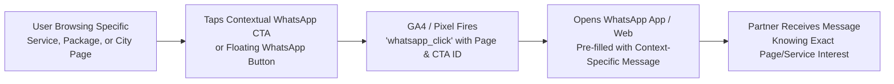

# 06 — User Experience (UX) & Customer Journeys

**Project:** Bayyora (بيّورا)  
**Author:** Agent 3 (Information Architecture & UX Agent)  
**Inputs:** `Doc A` (§2, §3), `01-PRD.md`, `03-BRAND-AND-DESIGN-SYSTEM.md`, `05-INFORMATION-ARCHITECTURE-AND-SITEMAP.md`  
**Status:** Complete Planning Specification

---

## 1. Core UX Principles

1. **Phone-First Ergonomics (`UX-001`):** Over 85% of local Saudi shop owners browse websites via mobile links shared on WhatsApp, Snapchat, Instagram, or Google Maps. Every layout is designed for a `360px–430px` viewport first, with `48px` minimum tap targets, short paragraphs (2–3 lines max), and thumb-reachable CTAs.
2. **Proof Before Pitch (`UX-004`):** A skeptical shop owner in Al-Hofuf or Dammam needs visual proof before reading marketing copy. Every page places a **Before → After** comparison high in the visual hierarchy.
3. **Consultative "Quote After We Talk" Flow (`BR-003`):** Because no prices are shown publicly, the UX must never make the user feel blocked by "hidden prices." Instead, every package and service card explains *why* quotes are tailored (*"Every shop is different — we check what you need first and send a clear written quote on WhatsApp"*) and offers an immediate 1-click path to the **Free Mini Audit** or **WhatsApp**.
4. **Directional Integrity (`UX-002`, `UX-003`):** Arabic (`dir="rtl"`) reads right-to-left with the Rising Line ascending toward the left; English (`dir="ltr"`) reads left-to-right with the Rising Line ascending toward the right.

---

## 2. Core Lead-Generation User Journeys

### 2.1 Journey 1: The 48-Hour Free Mini Audit Funnel (Primary Conversion Path)

```mermaid
flowchart LR
    A["Shop Owner Lands on<br/>Home (/), Service Page, or City Page"] --> B["Sees Before → After Visual<br/>& 'Free Mini Audit in 48h' CTA"]
    B --> C["Clicks 'اطلب تحليل مجاني'<br/>Navigates to /free-audit/"]
    C --> D["Reviews 6 Audit Checkpoints<br/>+ 1 Free Sample Gift Offer"]
    D --> E["Completes 6-Field GHL Form<br/>(Name, Shop, City, WhatsApp, IG, Need)"]
    E --> F["Clicks 'أرسل لي التحليل'"]
    F --> G["GHL Pipeline Creates Lead<br/>+ Fires GA4/Meta/Snap Event"]
    G --> H["Displays On-Page Bilingual Thank-You<br/>+ Optional Instant WhatsApp Chat Link"]
    H --> I["Partner Reviews 6 Checkpoints<br/>& Delivers Audit + Sample via WhatsApp <= 48h"]
```

- **Friction Reduction Rules:**
  - The `/free-audit/` form is capped at **6 fields**:
    1. Name (`الاسم` — required)
    2. Shop name (`اسم المحل` — required)
    3. City (`المدينة` — dropdown: `الأحساء / الهفوف / المبرّز / الدمام / الخبر / أخرى` — required)
    4. WhatsApp number (`رقم الواتساب` — `type="tel"`, `dir="ltr"`, placeholder `05xxxxxxxx` — required)
    5. Instagram link (`رابط الانستقرام` — optional text/URL so owners who only know their `@handle` don't get blocked by strict `https://` URL validation)
    6. What do you need help with? (`وش تحتاج مساعدة فيه؟` — multi-select checkboxes or dropdown + short note)
  - **Crucial UX Fix over `index.html`:** In `index.html`, the link input used `type="url"`, which causes mobile browsers to block submission if a shop owner types `@myshop` instead of `https://instagram.com/myshop`. In the Next.js React Hook Form + Zod schema, this field **must use `type="text"`** to accept either a full URL or an `@username` handle!

---

### 2.2 Journey 2: Contextual WhatsApp Click-to-Chat Journey

- **Contextual Pre-Filled Message Examples:**
  - On `/services/brand-identity/` (AR): `السلام عليكم، أبغى شعار لمحلّي`
  - On `/services/print-shop-design/` (AR): `السلام عليكم، أبغى أجدد لوحة محلي`
  - On `/packages/` (`Numow` card, AR): `السلام عليكم، أبغى عرض سعر وتحليل مجاني لباقة نمو`
  - On `/en/services/websites-online-stores/` (EN): `Hi, I'd like a website or store for my shop`
- **Floating WhatsApp Ergonomics:**
  - Positioned at `inset-inline-start: 20px; bottom: 20px` (`bottom-left` on Arabic RTL pages, `bottom-right` on English LTR pages).
  - On desktop (`> 720px`), displays WhatsApp icon + pill label (`كلّمنا` / `Chat with us`).
  - On mobile (`\le 720px`), collapses to a `52x52px` circular icon button so it never covers footer links or form submit buttons.

---

### 2.3 Journey 3: In-Person Shop Visit Booking Journey (`/contact/`)

1. **Entry Point:** Shop owner clicks *"احجز زيارة / Book a visit"* from the Homepage, About page (`/about/`), City pages (`/city/al-ahsa/`, `/city/hofuf/`), or main navigation (`/contact/`).
2. **Trust Framing:** Lands on `/contact/` with H1: **`نبدأ بزيارة، مو بعرض سعر` / `We start with a visit, not a price list`**.
3. **Action Choices:**
   - **Option A (Fastest):** Click *"راسلنا واتساب / WhatsApp us"* for immediate chat.
   - **Option B (Scheduled Visit):** Use the embedded **GoHighLevel Calendar widget** (`احجز زيارة / Book a visit`) to pick a convenient day and time (Sunday–Thursday, Saudi time `AST / UTC+3`) for Bayyora's local partner to visit their shop in Al Ahsa (Hofuf/Mubarraz), Dammam, or Khobar.
   - **Option C (Alternative):** Use the short contact form, direct phone call, or email.

---

## 3. Mobile Navigation & Interactive Component Behavior

### 3.1 Mobile Header & Drawer Behavior (`\le 720px`)
- **Top Bar (`height: 68px–74px`):**
  - Inline-start (Right in AR): Bayyora Rising Line logo lockup (`min-width: 120px`).
  - Inline-end (Left in AR): Compact Language Switch (`EN` / `عربي`), compact Saffron CTA pill (`تحليل مجاني` / `Free audit`), and `44x44px` Hamburger button (`aria-expanded`, `aria-controls`).
- **Slide-Down Navigation Drawer:**
  - Tapping the hamburger opens a full-width drawer over a `Sand` or `Najd Night` surface.
  - Displays the 6 main links with generous `14px` vertical tap padding.
  - Tapping `خدماتنا / Services` expands an accordion sub-list of all 9 services in sitemap order, plus a "See all services" link.
  - Drawer footer includes a full-width WhatsApp button (`راسلنا واتساب`) and working hours note.

### 3.2 Interactive Component Specifications
1. **Before → After Comparison Module:**
   - Supports two presentation modes depending on asset type:
     - **Side-by-Side Card Mode (Default for Google Maps & Multi-Metric Proof):** Used in the Homepage Hero and Ads/Local Search page; stacks cleanly on small screens (`< 480px`) or sits 2-up with clear `قبل / Before` and `بعد / After` badges and the Rising Line arrow between them.
     - **Interactive Split Slider / Toggle Mode (For Visual Makeovers — Logo, Signboard, Food Photo, IG Grid):** Allows the user to drag a Saffron handle (decorated with the Rising Line icon) or tap `قبل / Before` and `بعد / After` tabs to compare visual transformations on mobile without horizontal page scrolling issues. Both RTL and LTR drag directions are supported natively.
2. **Our Work (`/our-work/`) Dual Filter Bar:**
   - Two accessible pill-button filter groups:
     - **Filter Group 1 — Service (`الخدمة`):** `الكل (All)`, `شعار (Logo)`, `لوحة (Signboard)`, `سوشال (Social)`, `فيديو (Video)`, `موقع (Website)`.
     - **Filter Group 2 — Business Type (`نوع النشاط`):** `الكل (All)`, `مطعم (Restaurant)`, `كافيه (Café)`, `صيدلية (Pharmacy)`, `صالون (Salon)`, `تجزئة (Retail)`.
   - Filtering updates the visible portfolio grid smoothly with `aria-live="polite"` announcements and zero page reload; if a filter combination has no real work yet, it displays relevant badged **Sample Concepts (`نموذج توضيحي`)** and a prompt: *"Want to see a sample concept for your shop? Request a free mini audit."*
3. **Seasonal Banner State Management:**
   - The Homepage seasonal banner (`موسمك جاي… خلّ محلّك جاهز`) highlights the next upcoming Saudi commercial season (**Ramadan**, **Eid**, **Founding Day [22 Feb]**, **National Day [23 Sep]**, or **White Friday**) and can be switched from the **Payload Admin Dashboard** (`SiteSettings` or `SeasonalBannerBlock`) in 1 click without code changes.
4. **Admin Live Preview & Side-by-Side Localization Journey:**
   - Administrators editing any Page, Service, Package, Project, City, or Post in Payload CMS can toggle between **Arabic (`ar` RTL)** and **English (`en` LTR)** inside a split-screen **Next.js Draft Mode Live Preview** (`390px` mobile simulator or `1440px` desktop simulator) before publishing and triggering instant `revalidateTag` cache updates.

---

## 7. UI/UX Skills, Motion & WCAG 2.2 AA Enhancements (`24`–`28`)

All user journeys and interactive states defined in this document are governed by:
- **`24-UI-UX-SKILLS-AND-WORKFLOW.md`:** Mandatory routing through `.agents/skills/ui-ux-pro-max`, `.agents/skills/frontend-design`, `.agents/skills/web-animation-design`, and `.agents/skills/web-design-guidelines`.
- **`25-DESIGN-SYSTEM-SPECIFICATION.md`:** 3-item mobile header bar at `360px` (Logo + Compact CTA Pill + `44x44px` Hamburger, with Language Switcher inside the slide-over drawer to prevent horizontal overflow) and complete 6-state component specifications.
- **`26-MOTION-AND-ANIMATION-SYSTEM.md`:** `< 300ms` UI transition ceiling, `ease-out` enter/exit blueprint, `motion/react` (`LazyMotion` + `domAnimation`) for interactive islands, and compositor-only `clip-path` dragging on `BeforeAfterSlider`.
- **`27-ACCESSIBILITY-DESIGN-STANDARDS.md`:** Full **WCAG 2.2 Level AA** compliance including non-drag segmented controls on `BeforeAfterSlider` (`SC 2.5.7`), sticky-header/floating-WhatsApp focus clearance (`SC 2.4.11`), and session pre-fill to eliminate redundant data entry (`SC 3.3.7`).
