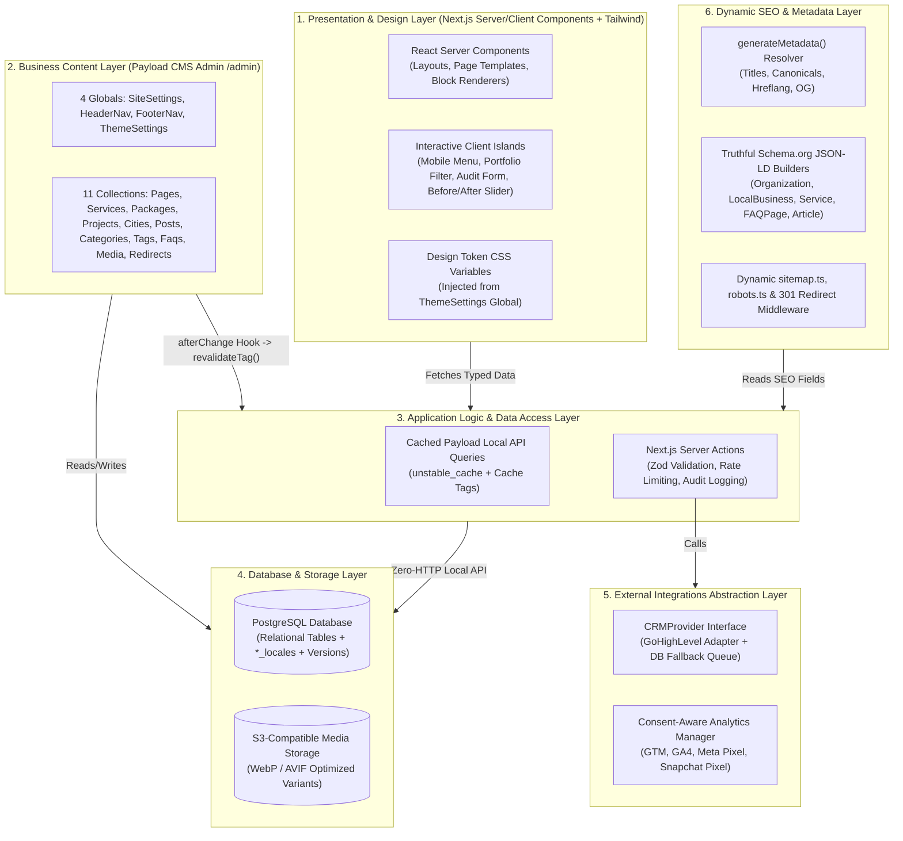

# 08 — Next.js, TypeScript, Tailwind CSS & Payload CMS Technical Architecture

**Project:** Bayyora (بيّورا)  
**Author:** Agent 5 (Technical Architecture Agent)  
**Replaces:** `08-WORDPRESS-TECHNICAL-ARCHITECTURE.md` *(Retired per Owner Architectural Mandate)*  
**Status:** Complete Technical Architecture Specification (Planning-Only Mode)

---

## 1. Mandatory Technology Stack Overview

WordPress is completely retired. Bayyora is architected as a unified, modern, type-safe full-stack TypeScript application powered by **Next.js (App Router)** and **Payload CMS 3.x (Next.js Native)** backed by **PostgreSQL**.

| Architectural Layer | Selected Technology | Architectural Role |
| :--- | :--- | :--- |
| **Framework & Routing** | **Next.js (App Router)** | Server-first routing (`src/app/`), React Server Components (RSC) by default, Server Actions for mutations, Metadata API (`generateMetadata`), dynamic `sitemap.ts` & `robots.ts`, and tag-based cache revalidation (`revalidateTag`). |
| **UI Runtime** | **React 19 / 18.3+ (Server + Client Islands)** | Zero-bundle-size Server Components for 90%+ of page markup; lightweight `'use client'` leaf components strictly where browser interactivity is required (header scroll state, mobile drawer, portfolio filter bar, Before/After slider, form inputs). |
| **Language** | **TypeScript (`strict: true`, `noUncheckedIndexedAccess: true`)** | End-to-end compile-time safety across database schemas, auto-generated Payload CMS types (`payload-types.ts`), Server Actions, and React component props. |
| **Styling & Design System** | **Tailwind CSS + CSS Custom Properties** | Utility-first styling using logical properties (`ms-*`, `me-*`, `ps-*`, `pe-*`, `start-*`, `end-*`) for seamless RTL (`ar`) / LTR (`en`) mirroring, bound to CMS-driven CSS variables from `ThemeSettings`. |
| **Headless / Integrated CMS** | **Payload CMS 3.x (`@payloadcms/next`)** | Runs natively inside the same Next.js App Router process (`/admin`), querying PostgreSQL directly via Payload's **Local API** inside Server Components with zero HTTP/network overhead. |
| **Primary Database** | **PostgreSQL (`@payloadcms/db-postgres` / Drizzle)** | Relational integrity for content relationships, localized tables (`*_locales`), media reference protection, version histories, and deterministic SQL schema migrations. |
| **Validation & Forms** | **Zod + React Hook Form** | Shared runtime validation schemas (`src/validations/`) enforced on both client forms and Next.js Server Actions, plus startup environment variable validation (`src/env.ts`). |
| **UI Primitives & Icons** | **Radix UI / `shadcn/ui` (Selective) + `lucide-react`** | WAI-ARIA compliant accessible primitives (Navigation Dropdown, Dialog/Drawer, Accordion, Select, Tabs) with native `dir="rtl"` support, plus tree-shaken Lucide icons and custom Bayyora SVGs. |
| **Testing & Quality** | **Vitest + React Testing Library + Playwright + `@axe-core/playwright`** | Unit/integration tests for utilities/schemas/actions, E2E bilingual & CMS workflow tests, and automated WCAG 2.1 AA accessibility & Lighthouse CI (`90+/95+/95+/100`) verification. |

---

## 2. Six-Layer Separation of Concerns

To satisfy the requirement that **changing a heading, image, package, SEO title, or page section never requires editing source code**, the system enforces strict boundaries across six layers:



---

## 3. Bilingual Next.js App Router Architecture (`/` AR & `/en/` EN)

### 3.1 Route Group & `[locale]` Directory Structure
Next.js App Router uses two top-level Route Groups so the public website and the Payload Admin Dashboard have completely isolated layouts and CSS bundles:
1. **`src/app/(payload)/`:** Hosts the Payload 3 Admin UI (`/admin/[[...segments]]`) and Payload REST/GraphQL/Preview endpoints (`/api/[...slug]`).
2. **`src/app/(frontend)/[locale]/`:** Hosts all public bilingual website routes.
   - **Middleware Rewriting (`src/middleware.ts`):** Uses `localePrefix: 'as-needed'` with `defaultLocale: 'ar'`:
     - Requests to `/` or `/services/brand-identity` are internally routed to `/ar` and `/ar/services/brand-identity` **without redirecting or showing `/ar/` in the browser URL bar**.
     - Requests to `/en` or `/en/services/brand-identity` are routed to `/en/...`.
     - If a user requests `/ar/...` explicitly, middleware issues a `308 Permanent Redirect` to `/...` to prevent duplicate URL indexing!
     - Middleware also checks the cached `Redirects` table to execute custom `301` / `302` redirects managed by the SEO Manager in the CMS.

### 3.2 Complete Repository & Folder Structure
```text
bayyora/
├── src/
│   ├── app/
│   │   ├── (frontend)/
│   │   │   └── [locale]/
│   │   │       ├── layout.tsx                 # Sets <html lang={locale} dir={dir}>, Readex Pro font, Theme CSS vars, Header, Footer, Floating WhatsApp
│   │   │       ├── page.tsx                   # Homepage (/ and /en) -> renders 'home' Page blocks
│   │   │       ├── not-found.tsx              # Localized 404 page
│   │   │       ├── [slug]/
│   │   │       │   └── page.tsx               # Dynamic CMS pages (/services, /packages, /our-work, /about, /free-audit, /contact, /faq, /privacy, /terms, /refunds)
│   │   │       ├── services/
│   │   │       │   └── [slug]/page.tsx        # Dynamic Service pages (/services/brand-identity, etc.)
│   │   │       ├── our-work/
│   │   │       │   └── [slug]/page.tsx        # Dynamic Case Study pages (/our-work/dawair, permission-gated)
│   │   │       ├── city/
│   │   │       │   └── [slug]/page.tsx        # Dynamic City pages (/city/al-ahsa, /city/hofuf, etc.)
│   │   │       └── blog/
│   │   │           ├── page.tsx               # Blog Archive (/blog)
│   │   │           └── [slug]/page.tsx        # Single Blog Article (/blog/[slug])
│   │   ├── (payload)/
│   │   │   ├── admin/[[...segments]]/page.tsx # Payload CMS Admin Dashboard
│   │   │   └── api/[...slug]/route.ts         # Payload API & Live Preview handlers
│   │   ├── api/
│   │   │   ├── draft/route.ts                 # Next.js Draft Mode activation for Live Preview
│   │   │   └── health/route.ts                # Uptime & DB health check endpoint
│   │   ├── sitemap.ts                         # Dynamic bilingual XML sitemap generator
│   │   └── robots.ts                          # Dynamic robots.txt generator
│   ├── payload.config.ts                      # Central Payload CMS configuration
│   ├── payload-types.ts                       # Auto-generated strict TypeScript interfaces for all collections/globals
│   ├── collections/                           # Payload Collection definitions (Pages, Services, Packages, Projects, Cities, Posts, Categories, Tags, Faqs, Media, Redirects, Users, AuditLogs)
│   ├── globals/                               # Payload Global definitions (SiteSettings, HeaderNav, FooterNav, ThemeSettings)
│   ├── blocks/                                # 15 Approved Page Builder Block schemas + React Server Component renderers
│   ├── components/
│   │   ├── layout/                            # Header, MobileDrawer (Client), Footer, LanguageSwitcher, FloatingWhatsApp
│   │   ├── ui/                                # Accessible primitives (Button, Card, Accordion, Badge, Select, Input)
│   │   ├── domain/                            # ServiceCard, PackageCard, BeforeAfterCard, PortfolioFilterGrid (Client), RisingLineSvg
│   │   └── forms/                             # FreeAuditForm (Client), ContactForm (Client), GhlCalendarEmbed (Client)
│   ├── actions/                               # Next.js Server Actions (submitAuditAction, submitContactAction)
│   ├── integrations/                          # CRMProvider interface, GhlAdapter, WhatsAppUrlBuilder, AnalyticsConsent
│   ├── seo/                                   # generatePageMetadata(), JsonLd builders, SeoAdminField plugins
│   ├── i18n/                                  # Locale config (ar default RTL, en LTR), dictionary fallbacks, routing helpers
│   ├── lib/
│   │   ├── payload-queries.ts                 # Cached Payload Local API data fetchers with cache tags
│   │   └── contrast-validator.ts              # WCAG 2.1 AA contrast ratio calculator for ThemeSettings
│   ├── validations/                           # Centralized Zod schemas (auditFormSchema, contactFormSchema)
│   ├── migrations/                            # Deterministic Drizzle/PostgreSQL migration files
│   └── env.ts                                 # Startup Zod validation for process.env
├── public/
│   └── fonts/readex-pro/                      # Self-hosted Readex Pro WOFF2 subsets (Arabic & Latin)
├── tests/
│   ├── unit/                                  # Vitest unit & integration tests
│   └── e2e/                                   # Playwright bilingual, accessibility & SEO E2E suites
├── next.config.mjs
├── tailwind.config.ts
└── tsconfig.json
```

---

## 4. Server vs. Client Component Boundary Rules

To achieve a **Mobile Lighthouse Performance score of 90+**, client-side JavaScript is minimized strictly:
- **Server Components (Default — 0 KB Client JS):**
  - Root Layout (`<html>`, `<head>`, JSON-LD injection, Theme CSS variable injection, Footer).
  - All 15 Page Builder Block wrappers (`HeroBlock`, `ServiceCardsBlock`, `PackageComparisonBlock`, `ProcessStepsBlock`, `WhyBayyora`, `SeasonalBannerBlock`, `CtaSectionBlock`).
  - Rich-text content rendering (Lexical-to-React Server Serializer), Breadcrumbs, Static Cards, and SEO metadata.
- **Client Components (`'use client'` — Strictly Isolated Leaf Nodes):**
  1. `HeaderScrollWrapper`: Listens to `window.scrollY > 40` (`passive: true`) to toggle the `Sand` $\rightarrow$ `Najd Night` sticky header class.
  2. `MobileNavDrawer`: Manages open/close state and focus trapping for the mobile hamburger menu.
  3. `PortfolioFilterGrid`: Filters the pre-rendered project cards by `Service` and `Business Type` on `/our-work` without full page reloads.
  4. `BeforeAfterSlider`: Handles touch/mouse drag on interactive image comparison sliders.
  5. `FreeAuditForm` & `ContactForm`: Manages `react-hook-form` input state, Arabic-Indic digit normalization (`٠-٩` $\rightarrow$ `0-9`), and invokes the Next.js Server Action via `useActionState` / `useTransition`.
  6. `CookieConsentBanner`: Manages Saudi PDPL analytics/pixel consent state.

---

## 5. Data Fetching, Caching & On-Demand Revalidation

Public pages are statically generated / cached at the edge and revalidated **instantly (< 500ms)** whenever an administrator publishes or updates content in Payload CMS:

```typescript
// Conceptual illustration of cached Local API query + tag revalidation
// 1. Data fetcher in src/lib/payload-queries.ts:
// Cached with granular tags: ['global:site-settings', 'collection:services', 'page:home:ar']
// 2. Payload afterChange hook on Services collection:
// Calls revalidateTag('collection:services') and revalidatePath('/services/' + doc.slug)
```

| Content Updated in Payload Admin | Cache Tags Invalidated (`revalidateTag`) | Result on Live Website |
| :--- | :--- | :--- |
| **`SiteSettings` / `HeaderNav` / `FooterNav` / `ThemeSettings`** | `global:layout`, `global:theme` | All pages update header, footer, WhatsApp number, or brand colors immediately on next request. |
| **Single `Page` (e.g., Homepage or About)** | `page:${slug}:${locale}`, `sitemap` | Only that page and `sitemap.xml` revalidate; all other pages remain cached. |
| **`Services` Collection Item** | `collection:services`, `service:${slug}:${locale}`, `page:home:${locale}`, `sitemap` | Updates the individual service page, the Services Hub, the Homepage 9-service grid, the Header dropdown, and `sitemap.xml`. |
| **`Packages` Collection Item** | `collection:packages`, `page:home:${locale}`, `page:packages:${locale}` | Updates package cards on both `/packages` and Homepage immediately. |
| **`Projects` / `Cities` / `Posts` / `Faqs`** | Respective collection tag + dependent hub pages + `sitemap` | Updates target pages and `sitemap.xml` with zero developer intervention or rebuild downtime. |


---

## 10. UI/UX, Design System & Motion Architecture Cross-References (`24`–`28`)

- **Workspace Agent Skills (`.agents/skills/`):** Configured and documented in `24-UI-UX-SKILLS-AND-WORKFLOW.md` and `28-SKILL-INSTALLATION-AND-INVENTORY.md`.
- **Design System & Token Binding:** `src/components/ui/` and `tailwind.config.ts` consume the centralized CSS custom properties defined in `25-DESIGN-SYSTEM-SPECIFICATION.md` and `18-DESIGN-CUSTOMIZATION-AND-THEMING.md`.
- **Animation Library Decision (`motion/react`):** Interactive client islands (`SeasonalCampaignTabs`, `PortfolioFilterGrid`, `BeforeAfterSlider`) use **Motion for React (`motion/react`)** wrapped in `<LazyMotion features={domAnimation}>` and `<MotionConfig reducedMotion="user">`, while simple hover/press/accordion states use zero-JS CSS transitions (`26-MOTION-AND-ANIMATION-SYSTEM.md`). GSAP is excluded from the core bundle.
- **WCAG 2.2 AA Enforcement:** All frontend layouts and components enforce `27-ACCESSIBILITY-DESIGN-STANDARDS.md`.


---

## 11. Remediated Specification Hardening (v2.1 — Closing `AUD-001` through `AUD-010`, `AUD-020`, `AUD-025`)

The following mandatory architectural rules override any earlier ambiguities in Sections 1–9:

1. **Pinned Runtime Matrix (`AUD-010`, `AUD-025`):**
   - `next`: **`^15.2.4`** (strictly `>= 15.2.3` to mitigate `CVE-2025-29927` `x-middleware-subrequest` bypass).
   - `react` & `react-dom`: **`^19.0.0`** (React 18.3 is unsupported with Payload 3.x and `useActionState`).
   - All Next.js 15 route components (`layout.tsx`, `page.tsx`, `generateMetadata`) must await asynchronous `params: Promise<{ locale: 'ar' | 'en'; slug?: string }>`, `searchParams`, `headers()`, `cookies()`, and `draftMode()`.
2. **Mandatory `overrideAccess: false` & Localized Publishing Filter on Public RSC Queries (`AUD-001`, `AUD-002`):**
   - Because Payload's Local API defaults to `overrideAccess: true`, **every** public Server Component query in `src/lib/payload-queries.ts` must explicitly pass:
     ```ts
     overrideAccess: false,
     user: undefined,
     draft: false,
     locale,
     fallbackLocale: false,
     where: {
       and: [
         { _status: { equals: 'published' } },
         { translationStatus: { equals: 'published' } },
       ],
     }
     ```
   - Furthermore, queries passing data to Client Islands must use explicit `select` projections so internal fields (`Packages.internalPriceSar`, `Projects.clientPermissionNote`) are never serialized into RSC Flight payloads.
3. **Draft Mode (`draftMode()`) Cache Isolation & `/api/draft` Authentication (`AUD-003`):**
   - `src/app/api/draft/route.ts` must verify **both** an authenticated Payload admin session via `const { user } = await payload.auth({ headers: await headers() })` **and** `crypto.timingSafeEqual` verification of `PREVIEW_SECRET`, and validate `slug` against `/^\/(?!\/)[a-zA-Z0-9\-\/]*$/` (preventing Open Redirect) before enabling Draft Mode.
   - In `src/lib/payload-queries.ts`, check `const { isEnabled: isDraft } = await draftMode()`. When `isDraft === true`, **bypass `unstable_cache` completely** and call `payload.find({ draft: true, overrideAccess: false, user })` so draft previews never poison the public ISR cache.
4. **Edge Middleware Scope & Node.js Redirect Resolution (`AUD-004`):**
   - `src/middleware.ts` matcher must strictly exclude `/admin`, `/api`, `/_next`, and static files (`matcher: ['/((?!api|admin|_next/static|_next/image|favicon.ico|.*\\..*).*)']`).
   - `src/middleware.ts` must **never** import `@payload-config` or query PostgreSQL directly in the Edge Runtime. CMS-managed `Redirects` (`301`/`302`) are resolved inside the Node.js Server Component catch-all / `notFound` boundary via `unstable_cache(getActiveRedirects, ['collection:redirects'])` + `permanentRedirect()`.
5. **CLI-Safe Revalidation Hooks (`AUD-007`):**
   - Every Payload `afterChange` and `afterDelete` hook calling `revalidateTag()` or `revalidatePath()` must check `if (context.disableRevalidate) return doc;` (set during `src/seed/` CLI execution) and wrap Next.js revalidation calls in a `try / catch` block.
6. **Static Edge Caching via `generateStaticParams()` & `setRequestLocale()` (`AUD-008`):**
   - `src/app/(frontend)/[locale]/layout.tsx` must export `generateStaticParams()` returning `[{ locale: 'ar' }, { locale: 'en' }]` and call `setRequestLocale(locale)` before rendering children so routes remain statically cached (`< 80ms` edge TTFB) instead of opting into Dynamic Rendering.
7. **Canonical Homepage Route Guard (`AUD-009`):**
   - In `src/app/(frontend)/[locale]/[slug]/page.tsx`, if `slug === 'home'`, immediately trigger `permanentRedirect(locale === 'ar' ? '/' : '/en')`. System page slugs (`home`, `services`, `packages`, `our-work`, `about`, `free-audit`, `contact`, `faq`, `privacy`, `terms`, `refunds`) are locked read-only after seeding.
8. **Synchronized Collection & Global Count (`AUD-020`):**
   - The architecture comprises exactly **14 Collections** (`Pages`, `Services`, `Packages`, `Projects`, `Cities`, `Posts`, `Categories`, `Tags`, `Faqs`, `Media`, `Redirects`, `LeadSubmissions`, `Users`, `AuditLogs`) and **5 Globals** (`SiteSettings`, `HeaderNav`, `FooterNav`, `ThemeSettings`, `UIStrings`).
