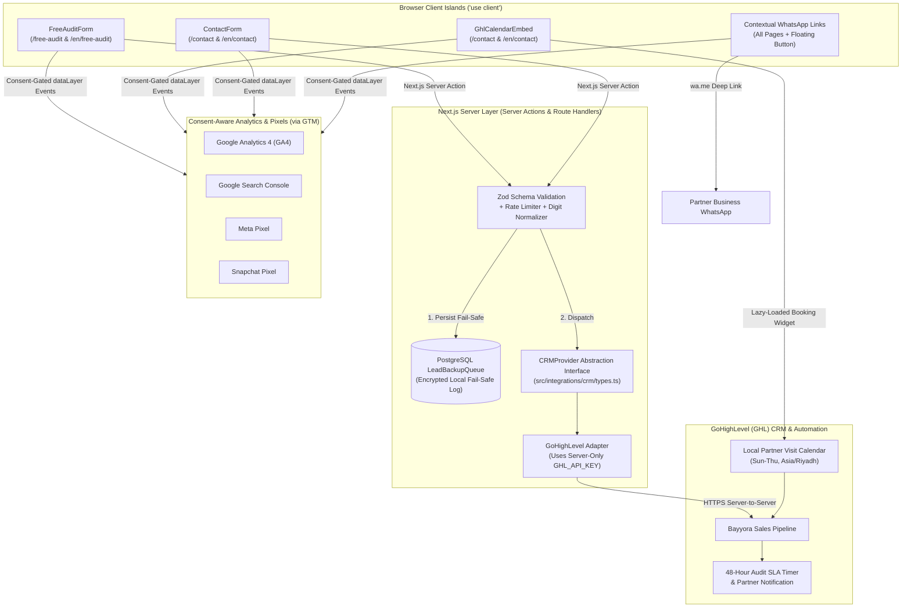

# 09 — Integrations, CRM Abstraction Layer & Lead Management Workflows (v2.0 — Next.js)

**Project:** Bayyora (بيّورا)  
**Author:** Agent 6 (Integrations & Lead Management Agent)  
**Inputs:** `Doc A` (§2, §3.7, §3.8), `01-PRD.md`, `08-NEXTJS-TECHNICAL-ARCHITECTURE.md`  
**Status:** Complete Next.js Integration Specification (No External Accounts Connected Prior to Approval)

---

## 1. Integration Architecture & Provider Abstraction Layer

To ensure that API keys and private credentials are **never exposed in the browser (`NEXT_PUBLIC_*`)** and that any external provider (such as GoHighLevel) can be replaced or upgraded in the future without rewriting frontend components, all external integrations are encapsulated behind a server-side TypeScript abstraction layer (`src/integrations/`).

### 1.1 TypeScript `CRMProvider` Interface (`src/integrations/crm/types.ts`)
By coding our Next.js Server Actions against `CRMProvider` rather than directly hardcoding GoHighLevel endpoints inside React forms:
- `submitAuditLead(payload: ValidatedAuditLead): Promise<CRMSubmissionResult>`
- `submitContactInquiry(payload: ValidatedContactInquiry): Promise<CRMSubmissionResult>`
- `getBookingCalendarUrl(locale: 'ar' | 'en'): string`
Swapping or adding a secondary CRM (e.g., HubSpot, Zoho Bigin, or a custom webhook) in the future requires only implementing a new adapter class with zero UI or form changes.

---

## 2. GoHighLevel (GHL) Forms, Zod Validation & Field Mapping (`INT-001`, `INT-002`)

### 2.1 Form 1: Free Mini Audit Form (`/free-audit` & `/en/free-audit`)
Handled by `FreeAuditForm.tsx` (`react-hook-form` + `zodResolver`) and processed server-side by `submitAuditAction` (`src/actions/submit-audit.ts`). Preserves all 6 documented fields from `Doc A` §3.7:

| # | Field Name (AR / EN) | Zod Schema Property | GHL Field Mapping | Input & Validation Rule |
| :--- | :--- | :--- | :--- | :--- |
| **1** | `الاسم` / `Name` | `name` | `contact.full_name` | `z.string().trim().min(2).max(100)` (Required) |
| **2** | `اسم المحل` / `Shop name` | `shopName` | `contact.company_name` | `z.string().trim().min(2).max(120)` (Required) |
| **3** | `المدينة` / `City` | `city` | `contact.city` | `z.enum(['al-ahsa', 'hofuf', 'mubarraz', 'dammam', 'khobar', 'other'])` (Required; options dynamically synced with `Cities` collection) |
| **4** | `رقم الواتساب` / `WhatsApp number` | `whatsapp` | `contact.phone` | Pre-transform normalizes Arabic-Indic digits (`٠-٩` $\rightarrow$ `0-9`), strips spaces, validates KSA mobile `^((\+?9665)|05)\d{8}$` (Required) |
| **5** | `رابط الانستقرام` / `Instagram link` | `instagramOrLink` | `contact.instagram_handle_or_url` | `z.string().trim().max(255).optional()` (`type="text"` — accepts `@handle`, Instagram URL, or Google Maps URL without blocking mobile users) |
| **6** | `وش تحتاج مساعدة فيه؟` / `What do you need help with?` | `helpNeeded` | `contact.audit_help_needed` | `z.string().trim().min(1).max(500)` (Select from CMS `Services` list or custom text) |
| *H1* | *Hidden: Active Locale* | `locale` | `contact.preferred_language` | `'ar' \| 'en'` |
| *H2* | *Hidden: Attribution* | `sourceUrl`, `utm_*` | `contact.attribution` | Captured server-side/client-side |

- **CMS-Editable Labels & Messages:** All field labels, placeholders, submit button copy (`أرسل لي التحليل` / `Send me my audit`), and thank-you message copy (`وصلنا طلبك! بنرسل لك التحليل على الواتساب خلال ٤٨ ساعة. وإذا حبيت، نرسل لك بعدها عرض سعر.` / `Got it! We'll send your audit on WhatsApp within 48 hours. If you like, we'll follow up with a quote.`) are stored in Payload CMS and editable via the Admin Dashboard.

### 2.2 Form 2: Short Contact Form (`/contact` & `/en/contact`)
Validated by `contactFormSchema` (`Name`, `Shop Name`, `City`, `WhatsApp/Phone`, `Message`, `Locale`) and submitted via `submitContactAction` to the `CRMProvider` and local fail-safe log.

---

## 3. GoHighLevel (GHL) Calendar: Shop Visit Booking (`/contact`)

Rendered on `/contact` and `/en/contact` via `GhlCalendarEmbed.tsx`:
- **Performance Optimization:** Uses `IntersectionObserver` (or a clean native step pre-selector) so the external GHL Calendar iframe/script loads only when the user scrolls to the booking section, protecting the **90+ Mobile Lighthouse Performance** score.
- **Timezone & Hours:** Locked to Saudi Arabia Standard Time (`Asia/Riyadh`, `UTC+3`), Sunday–Thursday (`الأحد إلى الخميس`), with 45–60 minute travel buffers between in-person shop visits across Al-Hofuf, Al-Mubarraz, Dammam, and Khobar.
- **CMS Configuration:** The GHL Calendar ID/URL for Arabic and English is stored in `SiteSettings.integrations.ghlCalendarIdAr` / `ghlCalendarIdEn` so administrators can update calendar links from the Admin Dashboard without redeploying code.

---

## 4. GoHighLevel CRM Pipeline & 48-Hour Audit Workflow

| Stage # | Stage Name | Entry Trigger | Automated GHL Actions & SLA Rules |
| :--- | :--- | :--- | :--- |
| **1** | **New Lead / Audit Requested** | `submitAuditAction` or `submitContactAction` succeeds. | • Tag lead with `lang:ar` or `lang:en`, `city:*`, and `source:free-audit`. • Send instant WhatsApp/Email alert to Local Partner & Creative Team. • **Start 48-Hour Audit SLA Timer.** |
| **2** | **Shop Visit Scheduled** | GHL Calendar booking completed on `/contact`. | • Send appointment confirmation + 24h & 2h WhatsApp reminders. • Assign field visit checklist to Local Partner. |
| **3** | **Audit & Free Sample In Progress** | Team claims the audit ticket (Target: `< 12h`). | • Team audits the 6 checkpoints (Google Maps, IG, Snap, TikTok, Website, 3 Competitors) + prepares 1 free sample (logo idea, sample post, or Maps fix). • **SLA Escalation:** Alert Partner & Owner at **Hour 36** if not yet delivered. |
| **4** | **Audit Delivered / Visit Completed** | Partner delivers Audit + Free Sample via WhatsApp (`\le 48h`). | • Log delivery timestamp. • Trigger 24h follow-up task for tailored quote. |
| **5** | **Quote Sent (On WhatsApp)** | Written quote (`Bidaya`, `Numow`, `Riyada`, `Look`, `Go Online`, or Single Service) sent on WhatsApp. | • Record quoted package in GHL Opportunity. • Schedule Day 3 and Day 7 follow-up tasks. |
| **6** | **Won — Onboarding** | Client approves quote & completes initial payment (`OD-009`). | • Trigger Client Onboarding Checklist (`11-BUSINESS-OPERATIONS-AND-COMPLIANCE.md`). |
| **7** | **Nurture / Seasonal Follow-Up** | Owner not ready immediately. | • Tag for seasonal campaign outreach (4 weeks prior to Ramadan, Eid, Founding Day, National Day, White Friday). |

---

## 5. Consent-Aware Analytics, Pixels & WhatsApp Click Tracking (`INT-003`)

Managed via `@next/third-parties/google` and a deferred GTM script loader (`AnalyticsManager.tsx`) that respects Saudi PDPL consent:
- **CMS-Configurable IDs (`SiteSettings.analytics`):** `gtmContainerId`, `ga4MeasurementId`, `metaPixelId`, `snapchatPixelId`, and `gscVerificationToken` can be viewed/updated by the Owner or SEO Manager in the Admin Dashboard.
- **Tracked `dataLayer` Events:**
  1. `whatsapp_click`: Fires via delegated listener on any `[data-wa-link]` element, passing `{ page_path, page_lang, cta_location, service_or_package_slug }`.
  2. `audit_form_submit`: Fires upon successful `submitAuditAction` response.
  3. `visit_booking_complete`: Fires upon GHL Calendar `postMessage` booking confirmation event.
  4. `contact_form_submit`: Fires upon successful `submitContactAction` response.

---

## 6. Resilient Failure Handling (Zero Lost Leads Guarantee)

Before `submitAuditAction` or `submitContactAction` calls the external GoHighLevel API:
1. The validated submission is **written immediately to the internal PostgreSQL `LeadSubmissions` collection** in Payload CMS (`syncStatus: 'pending'`).
2. If the GoHighLevel API responds with `200 OK`, `syncStatus` updates to `'synced'` with the `ghlContactId`.
3. If GoHighLevel experiences an outage, rate limit, or network timeout:
   - The user **still sees the clean on-page thank-you confirmation** (plus the optional 1-click *"Message us on WhatsApp now"* button) — never a broken error page.
   - `syncStatus` is marked `'failed_retry_queued'`, an instant fallback alert email is sent to Bayyora's team, and an admin retry button / background cron job syncs the lead to GHL once service is restored.

---

## 8. Remediated Security, Idempotency & Saudi PDPL Hardening (v2.1 — Closing `AUD-026`, `AUD-029`, `AUD-030`)

1. **Strict `instagramOrLink` Validation & CSV Injection Defense (`AUD-026`):**
   - `auditFormSchema.shape.instagramOrLink` is validated via a strict Zod union/refinement that accepts **only**:
     - A social handle matching `/^@?[a-zA-Z0-9._]{1,60}$/`, OR
     - A valid `https://` or `http://` URL parsed with `new URL()` whose hostname is a public domain (explicitly rejecting `javascript:`, `data:`, `file:`, `localhost`, and private/link-local IPs `127.0.0.0/8`, `10.0.0.0/8`, `169.254.0.0/16`).
   - All text fields (`name`, `shopName`, `instagramOrLink`, `helpNeeded`, `message`) strip or prefix leading spreadsheet formula characters (`=`, `+`, `-`, `@`, `\t`, `\r`) before storage or CSV export.
2. **Idempotent GoHighLevel Sync, Authenticated Retry Cron & Email Adapter (`AUD-029`):**
   - The sync status field is standardized across all documents as **`ghlSyncStatus`**: `'pending' | 'synced' | 'failed_retry_queued' | 'dead_letter'`.
   - Every submission computes a deterministic **`idempotencyKey`** (`SHA-256(normalizedWhatsapp + ':' + formType + ':' + YYYY-MM-DD-HH)`) with a unique PostgreSQL index, and records `ghlContactId`, `ghlOpportunityId`, `nextRetryAt`, and `lastError` so retrying a partially succeeded submission never creates duplicate GHL Opportunities.
   - The background retry endpoint (`/api/cron/retry-leads`) requires `Authorization: Bearer ${CRON_SECRET}` verified via `crypto.timingSafeEqual` and implements exponential backoff (`maxRetries: 5` before transitioning to `'dead_letter'`).
   - Payload CMS is configured with `@payloadcms/email-resend` (`RESEND_API_KEY` in `src/env.ts`) to guarantee delivery of fallback lead alert emails and admin password resets.
3. **Saudi PDPL Provable Consent, AES-256-GCM PII Encryption & 90-Day Auto-Purge (`AUD-030`):**
   - Both `auditFormSchema` and `contactFormSchema` include a required consent checkbox field `privacyConsentAccepted: z.literal(true)`, and the Server Action records `consentTimestamp` (ISO-8601) and `privacyPolicyVersion` (e.g. `'v1.0-2026-11'`) in `LeadSubmissions`.
   - `LeadSubmissions.payloadJson` is encrypted at rest at the application layer using **AES-256-GCM** (`crypto.createCipheriv('aes-256-gcm', LEAD_PII_ENCRYPTION_KEY, iv)`) inside Payload `beforeChange` / `afterRead` hooks.
   - A scheduled daily Payload job automatically purges/anonymizes `LeadSubmissions` records where `ghlSyncStatus === 'synced'` and `createdAt < NOW() - INTERVAL '90 days'`, fulfilling Saudi PDPL Article 18 data minimization and destruction mandates.
4. **Verified `postMessage` Origin & GHL Hostname Allowlist (`SEC-14`):**
   - `GhlCalendarEmbed.tsx` only fires `visit_booking_complete` when `event.origin === 'https://api.leadconnectorhq.com'`, and `SiteSettings.integrations.ghlCalendarIdAr/En` validates calendar embed URLs against `/^https:\/\/api\.leadconnectorhq\.com\/widget\/booking\/[a-zA-Z0-9_-]+$/`.
