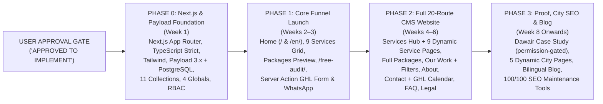

# 13 — Phased Implementation Roadmap & Dependency Plan (v2.0 — Next.js & Payload CMS)

**Project:** Bayyora (بيّورا)  
**Author:** Agent 0 (Project Orchestrator)  
**Inputs:** `Doc A` (§2 Build phases & Needed before building), `01-PRD.md` (v2.0), Specialist Plans `03`–`23`  
**Status:** Post-Approval Execution Plan (Strictly Gated Behind `"APPROVED TO IMPLEMENT"`)

---

## 1. Pre-Implementation Prerequisites ("Needed Before Building")

Per `Doc A` §2, the following business and brand prerequisites govern production go-live (while technical scaffolding and CMS seeding can run on Staging immediately after implementation approval):

| Prerequisite ID | Requirement from `Doc A` §2 | Linked Open Decision | Blocking Milestone | Owner / Responsible Party |
| :--- | :--- | :--- | :--- | :--- |
| **PRE-01** | **Domain confirmed** (`bayyora.com`, `bayyora.digital`, `bayyoradigital.com`, or `bayyora.sa`) | `OD-001` | Blocks Production DNS Cutover (Staging runs on preview domain) | Ataullah / Local Partner |
| **PRE-02** | **Ministry of Commerce trade-name search result for `بيّورا`** | `OD-002` | Blocks Final Legal Entity / CR Footer & Terms | Local Partner |
| **PRE-03** | **Approved colour palette** (`Najd Night #12233F`, `Saffron Rise #F2A541`, `Oasis Green #1F7A5C`, `Sand #F5EFE4`) | `OD-003` | Default seeded in `ThemeSettings` Global; updatable anytime via CMS | Ataullah |
| **PRE-04** | **Final drawn vector logo artwork** (Rising Line lockup + 4 variants) | `OD-005` | Swappable in 1 click via `SiteSettings` in Payload Admin | Ataullah / Brand Designer |
| **PRE-05** | **Saudi WhatsApp number, business email & working hours** | `OD-011` | Blocks Phase 1 Production Go-Live (managed in `SiteSettings`) | Ataullah / Local Partner |
| **PRE-06** | **6–10 sample before-and-after pieces** (badged `نموذج توضيحي / Sample concept`) | — | 2–3 needed for Phase 1 Hero; full 6–10 uploaded to `Projects` collection for Phase 2 | Creative Team |
| **PRE-07** | **Package inclusions signed off** (`Bidaya`, `Numow`, `Riyada`, `Look`, `Go Online`) | `OD-006`, `OD-007` | Seeded into `Packages` collection; editable anytime via Admin Dashboard | Ataullah |
| **PRE-08** | **Arabic copy reviewed by a native Saudi speaker** | `OD-004` | Reviewed via Payload Live Preview & `Arabic Translator` role before publishing | Native Saudi Reviewer / Local Partner |
| **PRE-09** | **Dawair's written permission to show their work** | `OD-008` | Blocks Phase 3 Dawair Case Study (`Projects.clientPermissionVerified = true`) | Local Partner + Dawair Owner |

---

## 2. Visual Phased Rollout Roadmap (Next.js + Payload CMS + PostgreSQL)

---

## 3. Detailed Phase Breakdown (Post-Approval Only)

### Phase 0: Next.js, Payload CMS & PostgreSQL Foundation (Week 1 Post-Approval)
- **Objective:** Establish the full-stack Next.js App Router + Payload CMS 3.x + PostgreSQL architecture, Admin Dashboard, and design token system.
- **Tasks:**
  1. Initialize Next.js App Router with TypeScript (`strict: true`), Tailwind CSS (logical RTL/LTR properties), ESLint, Prettier, Vitest, and Playwright.
  2. Configure **Payload CMS 3.x** (`@payloadcms/next`) with the **PostgreSQL adapter** (`@payloadcms/db-postgres`), initial Drizzle SQL migrations, and S3-compatible media storage (`sharp` WebP/AVIF pipeline).
  3. Implement the **4 Payload Globals** (`SiteSettings`, `HeaderNav`, `FooterNav`, `ThemeSettings` with WCAG contrast validator) and **11 Payload Collections** (`Pages`, `Services`, `Packages`, `Projects`, `Cities`, `Posts`, `Categories`, `Tags`, `Faqs`, `Media` with `beforeDelete` reference protection, `Redirects`, plus `Users` with 6 RBAC roles and `AuditLogs`).
  4. Configure `[locale]` routing (`/` for Arabic RTL default, `/en/` for English LTR), self-hosted `Readex Pro` (`next/font/local`), and Next.js `generateMetadata` + `sitemap.ts` + `robots.ts`.
  5. Build a deterministic seed script (`src/seed/`) to populate all documented Arabic and English copy from `Doc A` into PostgreSQL so zero content is hardcoded in components.

---

### Phase 1: Core Funnel Site Launch (Weeks 2–3)
- **Objective:** Launch the high-converting core funnel with full Admin Dashboard control so the local partner has a live, blazing-fast bilingual destination while pitching shops in Al Ahsa.
- **Routes & Blocks Delivered (3 Route Pairs = 6 Pages + Full Admin Dashboard):**
  1. **Home (`/` & `/en`):** Rendered dynamically from the `Pages` collection (`slug: 'home'`) via the reusable block engine (`HeroBlock` with Google Maps Before→After visual, `ServiceCardsBlock`, `BeforeAndAfterBlock`, `PackageComparisonBlock` [inclusions only, zero prices], `ProcessStepsBlock`, `WhyBayyoraBlock`, `SeasonalBannerBlock`, `FaqBlock`, `CtaSectionBlock`).
  2. **Free Mini Audit (`/free-audit` & `/en/free-audit`):** 6 audit checkpoints, 1-of-3 free gift callout, 6-field React Hook Form + Zod Server Action (`submitAuditAction`) connected to GoHighLevel via `CRMProvider` + PostgreSQL fail-safe backup log, and bilingual thank-you state.
  3. **Packages Preview (`/packages` & `/en/packages`):** Driven by the `Packages` collection (`Bidaya`, `Numow`, `Riyada`, `Look`, `Go Online`).
- **Phase 1 Quality Gate:** Mobile Lighthouse Performance $\ge 90$, Accessibility $\ge 95$, Best Practices $\ge 95$, **Lighthouse SEO: $100/100$**, Playwright E2E pass, and Native Saudi Reviewer approval via Payload Live Preview.

---

### Phase 2: Full Bilingual CMS Website Launch (Weeks 4–6)
- **Objective:** Launch the complete 20-route agency website with dynamic templates for all 9 services, portfolio filtering, visit booking calendar, FAQs, and legal pages.
- **Routes Added (17 Route Pairs = 34 Additional Pages):**
  1. **Services Hub (`/services` & `/en/services`).**
  2. **All 9 Dynamic Service Pages (`/services/[slug]` & `/en/services/[slug]`):** Powered by the `Services` collection (`brand-identity`, `print-shop-design`, `websites-online-stores`, `social-media`, `video-animation`, `photography`, `ads-local-search`, `whatsapp-follow-up`, `seasonal-campaigns`) — allowing future services to be added from the Admin Dashboard with zero code changes.
  3. **Full Packages Page (`/packages` & `/en/packages`):** Complete with Monthly tiers, Starter bundles, Single Services, Founding Offer toggle (`OD-007`), 3 quote steps, and 4 FAQs.
  4. **Our Work Hub (`/our-work` & `/en/our-work`):** Powered by the `Projects` collection with client-side dual filtering (Service + Business Type), Dawair teaser block, and automatic `نموذج توضيحي` / `Sample concept` badges.
  5. **About Page (`/about` & `/en/about`).**
  6. **Contact / Book a Visit (`/contact` & `/en/contact`):** Lazy-loaded GoHighLevel Calendar (`Asia/Riyadh`, Sun–Thu), direct WhatsApp, and Zod-validated short contact form (`submitContactAction`).
  7. **Standalone FAQ Page (`/faq` & `/en/faq`):** Powered by the `Faqs` collection + `FAQPage` JSON-LD schema.
  8. **3 Legal Pages (`/privacy`, `/terms`, `/refunds` & `/en/*`):** Managed in CMS (`Owner`/`Admin` publish lock) and reviewed by Saudi legal counsel.
- **Phase 2 Quality Gate:** Full 40-page Playwright + Lighthouse CI audit (`SEO = 100/100` on every indexable page), RBAC verification (`22-CMS-ADMIN-ACCEPTANCE-TESTS.md`), and GHL Calendar booking verification.

---

### Phase 3: Proof, Local City SEO & Blog Expansion (Week 8 Onwards)
- **Objective:** Scale organic visibility across the Eastern Province and publish verified client case studies and educational Arabic content directly from the CMS.
- **Routes Added (7 Route Pairs + Ongoing Blog = 14+ Additional Pages):**
  1. **Dawair Case Study (`/our-work/dawair` & `/en/our-work/dawair`):** Unlocked in CMS once written client permission (`OD-008`) is recorded (`clientPermissionVerified = true`).
  2. **5 Dynamic City Landing Pages (`/city/[slug]` & `/en/city/[slug]`):** Powered by the `Cities` collection (`al-ahsa`, `hofuf`, `mubarraz`, `dammam`, `khobar`) with unique local content, anti-duplication guardrails, and localized `LocalBusiness` JSON-LD — allowing new cities to be added from the Admin Dashboard anytime.
  3. **Bilingual Blog System (`/blog` & `/blog/[slug]`):** Powered by `Posts`, `Categories`, and `Tags` collections with scheduled publishing, auto reading-time, and `Article` JSON-LD (2 Arabic articles/month).
  4. **Verified Google Reviews Integration:** Enabled via CMS once real client reviews are collected on Bayyora's Google Business Profile.
