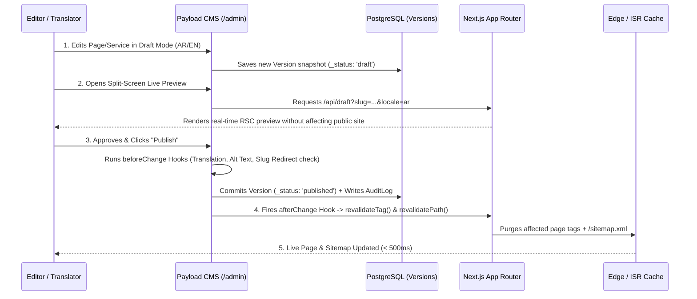

# 16 — CMS & Admin Dashboard Architecture (Payload CMS 3.x on Next.js)

**Project:** Bayyora (بيّورا)  
**Author:** Agent 5B (CMS & Admin Experience Agent)  
**Inputs:** Owner Architecture Mandate (§1, §2, §3, §6, §7), `01-PRD.md` (v2.0), `08-NEXTJS-TECHNICAL-ARCHITECTURE.md`  
**Status:** Complete CMS & Admin Specification (Planning-Only Mode)

---

## 1. Philosophy: 100% CMS-Driven Website, Zero Code Edits for Content

Bayyora's Admin Dashboard (`/admin`), powered by **Payload CMS 3.x integrated natively inside Next.js App Router**, is designed so a non-technical administrator, SEO manager, or Arabic reviewer can manage **every heading, paragraph, button label, WhatsApp pre-filled message, image, service, package deliverable quantity, portfolio item, city page, blog post, FAQ, navigation link, design token, and SEO tag** without ever opening a code file or redeploying the server.

---

## 2. Admin Dashboard Information Architecture (`/admin`)

The Payload Admin sidebar is organized into **8 intuitive operational groups** with bilingual UI labels (`ar` / `en` admin UI support):

| Sidebar Group | Globals / Collections Included | Primary User Roles |
| :--- | :--- | :--- |
| **1. Global Website & Theme (`إعدادات الموقع والمظهر`)** | • `SiteSettings` (Global) • `HeaderNav` (Global) • `FooterNav` (Global) • `ThemeSettings` (Global) | `Owner / Super Admin`, `Administrator` |
| **2. Website Pages (`صفحات الموقع`)** | • `Pages` (Collection — Block-Based Page Builder) | `Owner`, `Admin`, `Content Editor`, `SEO Manager`, `Arabic Translator` |
| **3. Services & Packages (`الخدمات والباقات`)** | • `Services` (Collection — 9 Core Services + Future) • `Packages` (Collection — Monthly & Starter Bundles) | `Owner`, `Admin`, `Content Editor`, `SEO Manager`, `Arabic Translator` |
| **4. Proof & Local Growth (`أعمالنا والمدن والأسئلة`)** | • `Projects` (Collection — Portfolio & Case Studies) • `Cities` (Collection — Local City Landing Pages) • `Faqs` (Collection — Categorized Q&A Bank) | `Owner`, `Admin`, `Content Editor`, `SEO Manager`, `Arabic Translator` |
| **5. Editorial Blog (`المدونة والمقالات`)** | • `Posts` (Collection — Bilingual Blog Articles) • `Categories` (Collection) • `Tags` (Collection) | `Owner`, `Admin`, `Content Editor`, `SEO Manager`, `Arabic Translator` |
| **6. Media Library (`مكتبة الوسائط`)** | • `Media` (Collection — Reference-Protected Assets) | All Editing Roles |
| **7. SEO & Redirects (`السيو والتحويلات`)** | • `Redirects` (Collection — 301/302 Redirect Manager) • `BrokenLinksReport` (Custom Admin View) | `Owner`, `Admin`, `SEO Manager` |
| **8. Leads, Users & Security (`العملاء والمستخدمين والأمان`)** | • `LeadSubmissions` (Collection — GHL Fail-Safe Queue) • `Users` (Collection — 6 RBAC Roles) • `AuditLogs` (Collection — Immutable Activity Log) | `Owner / Super Admin`, `Administrator` |

---

## 3. Global Settings, Header & Footer Management (§2.1 – §2.3)

### 3.1 `SiteSettings` Global (§2.1)
Centralizes all agency-wide identity, contact, and operational configurations:
- **Brand Identity:** `brandNameEn` (`Bayyora`), `brandNameAr` (`بيّورا` — validated to include shadda), `taglineAr` (`خطوة لفوق`), `taglineEn` (`One step up`), `logoVariants` (Full colour on light [RTL & LTR], Reversed on dark [RTL & LTR], Single-colour navy, Square icon), `favicon`.
- **Contact & Operations (`OD-011`):** `whatsappNumber` (normalized digits e.g. `9665XXXXXXXX`), `phoneNumber`, `businessEmail`, `workingHours` (localized text e.g. `الأحد إلى الخميس، ٩ ص – ٦ م`), `serviceAreas` (linked to `Cities`).
- **Social Media URLs (`OD-015`):** `snapchatUrl`, `instagramUrl`, `tiktokUrl`, `xUrl`.
- **Announcement & Seasonal Bar:** `announcementBar.enabled` (boolean), localized `text`, `ctaLabel`, `ctaUrl`, `seasonTheme` (`ramadan`, `eid`, `founding_day`, `national_day`, `white_friday`).
- **Global CTA & Pricing Governance (`OD-006`):** `globalAuditCtaText`, `globalWhatsappPrefillMessage`, and `publicPricingEnabled` (boolean — **locked to `false` by default**; only `Owner / Super Admin` can modify).
- **Default SEO & Localization:** `defaultMetaTitleSuffix`, `defaultMetaDescription`, `defaultOgImage`, `defaultLocale` (`ar`), `supportedLocales` (`['ar', 'en']`).

### 3.2 `HeaderNav` Global — Single Source of Truth (§2.2)
Eliminates hardcoded menus across desktop and mobile components:
- `navItems` (Reorderable Array):
  - `label` (localized `ar` / `en`)
  - `linkType` (`internal_page`, `services_dropdown`, `custom_url`)
  - `dropdownItems`: Auto-populates from published `Services` ordered by `displayOrder`, or allows custom curated service links + descriptions.
  - `isVisible` (boolean toggle)
- `primaryCta`: Localized `label` (`اطلب تحليل مجاني` / `Free mini audit`), `destination` (`/free-audit`), `styleVariant` (`saffron` | `whatsapp`).
- `languageSwitcher`: `enabled` (boolean), `arLabel` (`عربي`), `enLabel` (`EN`).
- `mobileMenuConfig`: `showStickyAuditCtaInTopBar` (boolean, default `true`), `drawerFooterWhatsappLabel`, `drawerWorkingHoursNote`.

### 3.3 `FooterNav` Global (§2.3)
- `footerLogoVariant` & localized `taglineOverride`.
- `columns`:
  1. `servicesColumn`: Title + dynamic/curated links to all 9 services.
  2. `companyColumn`: Title + links (`About`, `Our work`, `Packages`, `FAQ`, `Blog`).
  3. `citiesColumn`: Title + dynamic/curated links to `Cities` (`Al Ahsa`, `Hofuf`, `Mubarraz`, `Dammam`, `Khobar`).
  4. `contactColumn`: Pulls automatically from `SiteSettings` (with optional overrides) + Social icon toggles.
- `footerCtaBand`: Default pre-footer dark `Najd Night` CTA band configuration.
- `legalLinks`: Array linking to `/privacy`, `/terms`, `/refunds` + localized `copyrightText`.

---

## 4. The 15-Block Brand-Safe Page Builder (§2.4)

Every page in the `Pages` collection uses a structured `layout` blocks field (`minRows: 1`). Administrators can **add, reorder via drag-and-drop, duplicate, toggle `isVisible: true/false`, and choose from approved `layoutVariant` presets** — without arbitrary CSS controls that could break responsive layouts or WCAG contrast:

| # | Block Slug | Block Name & Purpose | Approved Layout Variants & Safety Guards |
| :--- | :--- | :--- | :--- |
| **1** | `hero` | **Hero Section:** H1, rising line tagline, subline, primary/secondary CTAs, trust note, and visual showcase. | Variants: `split_maps_compare` (Homepage), `split_image`, `centered_minimal`. |
| **2** | `textAndImage` | **Text & Image Split:** Rich text, bullet points, CTA, and `next/image` asset or brand card. | Variants: `image_end` (default), `image_start`, `navy_feature_card` (used on About page). |
| **3** | `serviceCards` | **Service Cards Grid:** Displays all 9 services (or selected subset) from `Services` collection. | Variants: `grid_3col_compact` (Home), `grid_3col_detailed` (Services Hub), `pain_strip_4col`. |
| **4** | `packageComparison` | **Package Comparison:** Renders Monthly (`Bidaya`, `Numow`, `Riyada`) and/or Starter Bundles (`Look`, `Go Online`) from `Packages`. | Enforces `SiteSettings.publicPricingEnabled = false` automatically; highlights `Numow` in `Najd Night`. |
| **5** | `beforeAndAfter` | **Before & After Showcase:** Renders selected `Projects` or custom side-by-side comparison metrics. | Variants: `side_by_side_cards`, `interactive_slider`. Auto-applies `نموذج توضيحي / Sample concept` badge when `isSampleConcept = true`. |
| **6** | `statistics` | **Verified Statistics Band:** Numeric metrics block. | **Hard Guard (`BR-009`):** Requires `verificationSourceNote` and `Owner` approval checkbox before rendering; prevented from publishing unverified numbers. |
| **7** | `portfolioGrid` | **Portfolio Grid with Dual Filter:** Renders `Projects` with interactive `Service` + `Business Type` filter pills. | Variants: `filterable_full` (`/our-work`), `featured_3col` (Home / City pages). |
| **8** | `processSteps` | **Process Steps (`How It Works`):** 3 or 4 numbered step cards with Rising Line progression. | Variants: `steps_4col_numbered`, `steps_3col_horizontal`. |
| **9** | `faqSection` | **FAQ Accordion Section:** Pulls selected questions from `Faqs` collection or page-specific FAQs. | Optional `emitFaqSchema` toggle (enabled on `/faq` and service pages). |
| **10** | `testimonial` | **Client Testimonial Block:** Displays client quote and attribution. | **Hard Guard (`BR-009`):** Cannot be enabled unless linked to a `Project` with `clientPermissionVerified = true`. |
| **11** | `ctaSection` | **CTA Band:** High-contrast conversion band (`Najd Night` or `Sand` surface) with Rising Line arrow and dual CTAs. | Variants: `najd_night_full`, `sand_card_inset`, `founding_offer_banner`. |
| **12** | `imageGallery` | **Image Gallery:** Responsive grid of `Media` assets with lightbox and localized captions. | Variants: `grid_2col`, `grid_3col`, `masonry_aspect_4_3`. |
| **13** | `clientLogos` | **Client Logos Strip:** Displays approved client logos. | **Hard Guard (`BR-009`):** Every logo entry requires `writtenPermissionVerified = true` before rendering. |
| **14** | `seasonalBanner` | **Seasonal Campaign Banner:** Highlighted seasonal callout with season selector pills (`Ramadan`, `Eid`, `Founding Day`, `National Day`, `White Friday`). | Variants: `interactive_season_pills`, `urgent_season_hero`. |
| **15** | `contactSection` | **Contact & Booking Hub:** Renders Free Audit 6-field form, GHL Visit Calendar + Contact form, and contact details list. | Variants: `free_audit_split` (`/free-audit`), `visit_booking_hub` (`/contact`). |

---

## 5. Domain Collection Management (§2.5 – §2.11)

1. **`Services` Collection (§2.5):** Stores all 9 services (`brand-identity`, `print-shop-design`, `websites-online-stores`, `social-media`, `video-animation`, `photography`, `ads-local-search`, `whatsapp-follow-up`, `seasonal-campaigns`). Adding a 10th service in the Admin Dashboard automatically creates its `/services/[slug]` and `/en/services/[slug]` pages, adds it to `sitemap.xml`, and makes it selectable in `HeaderNav`, `FooterNav`, `Packages`, and `Projects`.
2. **`Packages` Collection (§2.6):** Manages `Bidaya`, `Numow`, `Riyada` (`packageType: 'monthly'`) and `Look`, `Go Online` (`packageType: 'one_time_bundle'`). Deliverable quantities (`10 designs`, `8 stories`, `2 reels`, etc.) are structured editable fields so the owner can adjust inclusions anytime without touching code.
3. **`Projects` Collection (§2.7):** Manages portfolio items and case studies (`Dawair`). Enforces two critical flags:
   - `isSampleConcept` (boolean, defaults to `true`): Automatically displays the mandatory **`نموذج توضيحي` / `Sample concept`** badge on the frontend.
   - `clientPermissionVerified` (boolean, defaults to `false`): Required to set `isSampleConcept = false` or publish a full case study page (`/our-work/dawair`).
4. **`Cities` Collection (§2.8):** Manages `Al Ahsa`, `Hofuf`, `Mubarraz`, `Dammam`, and `Khobar`. Creating a new city record (e.g., `Jubail` or `Qatif`) automatically generates `/city/[slug]` and `/en/city/[slug]`. Includes an **anti-doorway similarity check hook** that warns editors if city intro/body copy duplicates another city page by $> 40\%$.
5. **`Posts`, `Categories`, `Tags` (§2.9) & `Faqs` (§2.10):** Full bilingual blog system (with scheduled publishing via Payload Jobs Queue and auto-computed reading time) and reusable categorized FAQ repository.
6. **`Media` Collection with Reference Protection (§2.11):**
   - Stores localized `alt` text (`ar` & `en` — required for image assets), localized `caption`, `focalX`/`focalY` coordinates, and `sha256Hash` (warns if uploading an identical duplicate file).
   - Automatically generates optimized `WebP` and `AVIF` responsive sizes (`thumbnail: 400w`, `card: 800w`, `hero: 1400w`, `og: 1200x630`).
   - **Reference Check (`beforeDelete` Hook):** Queries all collections/globals referencing the `media.id`. If any published document references the image, deletion is **blocked** with a clear message listing the exact pages/services using that image.

---

## 6. Role-Based Access Control (6 Administrative Roles — §6)

| Capability / Resource | 1. `Owner / Super Admin` | 2. `Administrator` | 3. `Content Editor` | 4. `SEO Manager` | 5. `Arabic Translator` | 6. `Viewer / Reviewer` |
| :--- | :---: | :---: | :---: | :---: | :---: | :---: |
| **Manage Users, Roles & Security (`Users`, `AuditLogs`)** | Full | Read / Manage Editors | None | None | None | None |
| **Modify `ThemeSettings` & `SiteSettings.publicPricingEnabled`** | **Full (Exclusive)** | Read-Only | None | None | None | Read-Only |
| **Publish Legal Pages (`/privacy`, `/terms`, `/refunds`)** | **Full** | **Full** | Draft Only | SEO Fields Only | AR Draft Only | Read / Preview |
| **Create / Edit / Publish Pages, Services, Packages, Projects, Cities, Blog, FAQs** | Full | Full | Create / Edit / Publish (Non-Legal) | Edit SEO & Links Only | Edit `ar` Locale & Translation Status | Read / Live Preview Only |
| **Manage `Redirects`, Canonicals, Robots, Schema & SEO Tools** | Full | Full | Read-Only | **Full** | Read-Only | Read-Only |
| **Media Upload & Replacement** | Full | Full | Upload / Edit | Edit Alt Text | Edit AR Alt Text | Read-Only |
| **View `LeadSubmissions` (CRM Backup Queue)** | Full | Full | None | None | None | None |

---

## 7. Complete Publishing, Preview, Versioning & Rollback Workflow (§7)

- **Version History & 1-Click Rollback:** Every collection and global preserves up to `50` historical versions in PostgreSQL (`versions: { drafts: true, maxPerDoc: 50 }`), recording the exact timestamp, user ID, and diff. An authorized user can restore any prior version in 1 click, which immediately triggers `revalidateTag()` to roll back the live public page.
- **Automatic 301 Redirect on Slug Change:** If an administrator changes the URL `slug` of an already-published Page, Service, Project, City, or Blog Post, a `beforeChange` hook automatically inserts a `301 Permanent Redirect` from the old URL (both `/old-slug` and `/en/old-slug`) to the new URL in the `Redirects` collection.

---

## 8. Remediated CMS Governance, 5th Global (`UIStrings`) & Field-Level RBAC (v2.1 — Closing `AUD-005`, `AUD-012`, `AUD-015`, `AUD-016`, `AUD-045`)

1. **5th Global Singleton: `UIStrings` (`slug: 'ui-strings'` — `AUD-012`):**
   - Eliminates all remaining hardcoded strings in `src/i18n/` by providing localized (`ar`/`en`) admin-editable tabs for:
     - `auditFormUi`: Field labels, placeholders, helper text, validation error messages, submit button text, and post-submit confirmation copy.
     - `contactFormUi`: Short-form labels, placeholders, validation messages, and booking tab headings.
     - `serviceTemplateHeadings`: Recurring section H2 labels (`المشكلة / The problem`, `وش تحصل؟ / What you get`, `قبل وبعد / Before & after`, `موجودة في / Included in`, `كيف نشتغل؟ / How it works`, `أسئلة شائعة / FAQ`).
     - `portfolioFilterUi`: Filter bar labels (`الكل / All`, service/business filter labels, empty-state text, and `نموذج توضيحي / Sample concept` badge text).
     - `blogIndexPage`: `/blog` & `/en/blog` H1 title, subtitle, category filter label, and `seo: seoFields`.
     - `cookieBannerUi` & `notFoundPageUi`: Saudi PDPL cookie consent copy/buttons and localized 404 page heading/CTA.
2. **Expanded `SiteSettings` Legal, Analytics & CRM Fields (`AUD-012`, `AUD-015`):**
   - Adds `legalAndCompliance` group: `legalEntityName` (localized), `commercialRegistrationNumber` (`رقم السجل التجاري - CR`), `vatRegistrationNumber` (`الرقم الضريبي - ZATCA`), `saudiBusinessCenterAuthId` & `saudiBusinessCenterUrl` (`توثيق المركز السعودي للأعمال`, replacing retired `Maroof`), and `nationalAddress` (localized).
   - Adds `integrations` group (`ghlCalendarIdAr`, `ghlCalendarIdEn`, `foundingOfferBanner` toggle & copy) and `analytics` group (`gtmId`, `ga4MeasurementId`, `metaPixelId`, `snapPixelId`, `tiktokPixelId`).
3. **Strict Field-Level RBAC & Publishing Guards (`AUD-005`, `AUD-016`, `AUD-045`):**
   - **`Users.roles` Privilege Escalation Guard:** Field-level `access: { update: isOwner }` and a `beforeChange` hook prevent `Administrator` from assigning `'owner'` or `'admin'` roles or modifying `Owner` accounts.
   - **Compliance Checkbox Guards:** Field-level `access: { update: isOwnerOrAdmin }` is enforced on `Pages.isLegalPage`, `Projects.clientPermissionVerified`, `Projects.clientPermissionNote`, `Projects.sfdaComplianceVerified`, `Projects.mawthooqLicenseVerified`, `Posts.sfdaComplianceVerified`, `Posts.mawthooqLicenseVerified`, and `StatisticsBlock.ownerApproved`.
   - **Inline `beforeAndAfter` Block Guard (`AUD-045`):** Requires either linking a permission-verified `Project` record or enabling `isSampleConcept: true` (`نموذج توضيحي`).
   - **Server-Side Publishing & Locale Guard:** A shared `beforeChange` hook across all draft-enabled collections rejects `_status === 'published'` if the actor is `seo_manager`, `arabic_translator`, `viewer`, or (`editor` when `originalDoc.isLegalPage === true`). For `arabic_translator`, collection `access.update` requires `req.locale === 'ar'`, and all non-localized (`localized: false`) fields set `access.update: isOwnerAdminOrEditor`.
