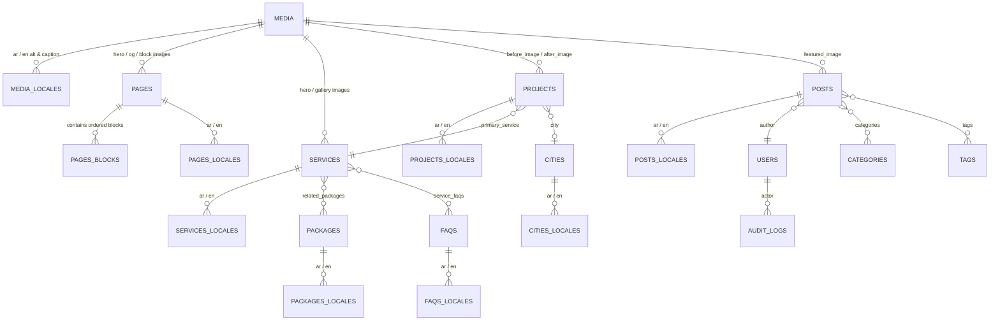

# 17 — Content Models & Database Schema Specification (PostgreSQL + Payload CMS)

**Project:** Bayyora (بيّورا)  
**Author:** Agent 5 (Database & Technical Architecture Agent)  
**Inputs:** Owner Architecture Mandate (§1, §2, §3), `08-NEXTJS-TECHNICAL-ARCHITECTURE.md`, `16-CMS-ADMIN-ARCHITECTURE.md`  
**Status:** Complete Content Model & Database Architecture (Planning-Only Mode)

---

## 1. Database Architecture Evaluation: PostgreSQL vs. MongoDB

Payload CMS 3.x natively supports two official database adapters: **PostgreSQL (`@payloadcms/db-postgres` via Drizzle ORM)** and **MongoDB (`@payloadcms/db-mongodb` via Mongoose)**. Below is an objective evaluation across all eight mandated engineering criteria for Bayyora's requirements:

| Evaluation Criterion | **PostgreSQL (`@payloadcms/db-postgres`) — RECOMMENDED** | **MongoDB (`@payloadcms/db-mongodb`)** | Winner for Bayyora |
| :--- | :--- | :--- | :--- |
| **1. Data Relationships** | Enforces strict **ACID foreign-key relationships** across join tables (`Services <-> Packages`, `Projects <-> Services/Cities`, `Media` references). Prevents orphaned records and enforces `ON DELETE RESTRICT` at the database level so in-use media files can never be accidentally deleted. | Uses document ObjectIDs without native cross-collection foreign-key constraints; referential integrity relies entirely on application-layer hooks. | **PostgreSQL** |
| **2. Localization (`ar` & `en`)** | Stores localized fields in dedicated, indexed `*_locales` tables (`_locale = 'ar' \| 'en'`, `_parent_id`). Enables fast SQL queries for translation completeness (`WHERE _locale = 'en' AND meta_title IS NULL`) and clean addition of future languages. | Embeds locale objects (`{ ar: ..., en: ... }`) inside BSON documents. As documents grow with blocks and versions, BSON document size increases across all locales simultaneously. | **PostgreSQL** |
| **3. Content Structure** | Bayyora's domain model (9 Services, 5 Packages with structured quantities, 5+ Cities, Portfolio items, FAQs, Redirects, and 15 structured Page Builder blocks) is highly structured and relational. | Best suited for unstructured, schema-less documents; offers no structural advantage when Payload already enforces strict TypeScript collection schemas. | **PostgreSQL** |
| **4. Query Performance** | Payload 3's Drizzle adapter executes optimized relational queries with B-tree indexes on `slug`, `_status`, `_locale`, and foreign keys. Fetching a localized page with its related services/packages completes in `< 5–12ms`. | Requires `$lookup` aggregation pipelines when resolving deeply nested relationships across collections and versions. | **PostgreSQL** |
| **5. Backup & Recovery** | Industry-standard `pg_dump` logical backups plus continuous **Write-Ahead Log (WAL) Point-in-Time Recovery (PITR)** to the exact second on every managed provider (Neon, Supabase, AWS RDS, Railway). | Atlas continuous backups cost extra on higher tiers; `mongodump` requires replica-set oplog coordination for point-in-time recovery. | **PostgreSQL** |
| **6. Data Migration** | **Deterministic, version-controlled SQL migrations** (`payload migrate:create`, `payload migrate`) committed to Git (`src/migrations/`). Guarantees Staging and Production schemas stay 100% synchronized in CI/CD. | Schema-less by default; structural changes require custom imperative Node.js data-patching scripts. | **PostgreSQL** |
| **7. Hosting & Operating Costs** | Generous, predictable pricing on modern serverless/managed Postgres platforms (Neon, Supabase, Railway, AWS RDS) with low RAM overhead (~`$0–$25/mo` at agency scale). | MongoDB Atlas dedicated clusters with production backup/VPC guarantees jump steeply in monthly cost (`$57+/mo` for M10+). | **PostgreSQL** |
| **8. Long-Term Maintenance** | Standard SQL introspection, strict types via Drizzle, zero risk of the 16MB BSON document limit even with 50 version snapshots per page. | Version snapshots containing large nested block arrays in multiple locales can bloat BSON collection storage over time. | **PostgreSQL** |

### Primary Database Decision (`REC-006`)
**Recommendation:** Select **PostgreSQL 16+** (via `@payloadcms/db-postgres`) as Bayyora's primary database. It provides superior relational integrity for our interconnected Services/Packages/Projects/Media graph, deterministic Git-tracked SQL migrations for CI/CD safety, and lower long-term operating cost.

---

## 2. Entity-Relationship Diagram (PostgreSQL Schema)

---

## 3. Shared Reusable Field Groups

Every public-facing collection (`Pages`, `Services`, `Packages`, `Projects`, `Cities`, `Posts`) embeds two standardized field groups:

### 3.1 `seoFields` Group (Localized `ar` & `en`)
| Field Name | Type | Localized? | Validation & Behavior |
| :--- | :--- | :---: | :--- |
| `metaTitle` | `text` | Yes (`ar`, `en`) | Custom admin UI character counter (Target: `30–60` chars; falls back to document title + `SiteSettings.defaultMetaTitleSuffix` if left blank, never overwrites custom value). |
| `metaDescription` | `textarea` | Yes (`ar`, `en`) | Custom admin UI character counter (Target: `70–155` chars; falls back to excerpt/subline if blank). |
| `canonicalUrl` | `text` | Yes (`ar`, `en`) | Optional manual override; defaults to self-referencing canonical URL (`https://<DOMAIN>/...`). |
| `noIndex` | `checkbox` | No (or per-locale) | Defaults to `false` (`index, follow`). If `true`, outputs `noindex, nofollow` and excludes page from `/sitemap.xml`. |
| `ogTitle` / `ogDescription` | `text` / `textarea` | Yes (`ar`, `en`) | Optional social overrides (falls back to `metaTitle` / `metaDescription`). |
| `ogImage` | `upload -> Media` | Yes (`ar`, `en`) | Optional 1200x630 social image (falls back to `heroImage` or `SiteSettings.defaultOgImage`). |
| `focusKeyword` | `text` | Yes (`ar`, `en`) | Editorial helper for SEO Manager (analyzes presence in H1, metaTitle, and body). |
| `structuredDataOverride` | `json` | Yes (`ar`, `en`) | Optional custom JSON-LD extension validated against Schema.org rules. |

### 3.2 `publishingAndTranslationFields` Group
- `_status`: `'draft' | 'published'` (Native Payload Drafts & Versions).
- `translationStatus`: Localized `'draft' | 'in_review' | 'approved' | 'published'` (`ar` and `en` tracked independently).
- `whatsappPrefillMessage`: Localized `text` (`ar` and `en`) for contextual page CTAs.

---

## 4. Complete Collection Schemas (13 Collections)

### 4.1 `Pages` (`slug: 'pages'`)
- `slug`: `text` (Unique, indexed, clean Latin slug e.g. `home`, `services`, `packages`, `our-work`, `about`, `free-audit`, `contact`, `faq`, `privacy`, `terms`, `refunds`).
- `isLegalPage`: `checkbox` (If `true`, restricts publishing to `Owner` and `Administrator` roles).
- `title`: `text` (Localized `ar`, `en`, required).
- `subtitle`: `textarea` (Localized `ar`, `en`).
- `layout`: `blocks` (Localized or shared structure with localized fields across the **15 Approved Blocks** defined in `16-CMS-ADMIN-ARCHITECTURE.md` §4).
- `seo`: `seoFields`.

### 4.2 `Services` (`slug: 'services'`) — All 9 Services + Future Extensibility
- `slug`: `text` (Unique, indexed: `brand-identity`, `print-shop-design`, `websites-online-stores`, `social-media`, `video-animation`, `photography`, `ads-local-search`, `whatsapp-follow-up`, `seasonal-campaigns`).
- `displayOrder`: `number` (Indexed, `1` through `9+`).
- `name`: `text` (Localized `ar`, `en`, required — e.g. `الهوية والشعار` / `Brand and identity`).
- `benefitHeadline`: `text` (Localized `ar`, `en`, required — H1 e.g. `شعار يتذكّره الناس` / `A logo people remember`).
- `shortDescription`: `textarea` (Localized `ar`, `en` — card summary).
- `iconName`: `select` (Approved Lucide/Bayyora icon tokens: `pen-tool`, `printer`, `monitor`, `instagram`, `video`, `camera`, `trending-up`, `message-circle`, `calendar`).
- `heroImage`: `upload -> Media`.
- `gallery`: `array` of `upload -> Media`.
- `problemStatement`: `textarea` (Localized `ar`, `en` — `المشكلة / The problem`).
- `deliverables`: `array` of `{ itemText (localized) }` (`وش تحصل؟ / What you get`).
- `benefits`: `array` of `{ title (localized), description (localized) }`.
- `beforeAfterProjects`: `relationship -> Projects` (`hasMany: true`).
- `relatedPackages`: `relationship -> Packages` (`hasMany: true`) + `packageInclusionNote` (Localized `ar`, `en` — `موجودة في / Included in`).
- `processSteps`: `array` (`minRows: 3, maxRows: 4`) of `{ stepTitle (localized), stepDescription (localized) }` (`كيف نشتغل؟ / How it works`).
- `faqs`: `relationship -> Faqs` (`hasMany: true`) + inline `customFaqs` array.
- `primaryCtaLabel`: `text` (Localized `ar`, `en` — e.g. `أبغى شعار لمحلّي` / `I'd like a logo for my shop`).
- `whatsappPrefillMessage`: `text` (Localized `ar`, `en`).
- `seo`: `seoFields`.

### 4.3 `Packages` (`slug: 'packages'`) — Monthly & One-Time Starter Bundles
- `slug`: `text` (`bidaya`, `numow`, `riyada`, `look`, `go-online`).
- `packageType`: `select` (`'monthly' | 'one_time_bundle'`).
- `displayOrder`: `number` (Indexed).
- `isVisible`: `checkbox` (Default `true`).
- `isHighlighted`: `checkbox` (Default `true` for `Numow / نمو`, rendering the `Najd Night` card & Saffron badge).
- `badgeText`: `text` (Localized `ar`, `en` — e.g. `الأكثر طلبًا` / `Most popular`).
- `name`: `text` (Localized `ar`, `en` — e.g. `بداية` / `Bidaya`).
- `positioningSubline`: `text` (Localized `ar`, `en` — e.g. `الخطوة الأولى` / `The first step`).
- `description`: `textarea` (Localized `ar`, `en`).
- `quantifiedDeliverables`: `group` (Editable numbers/text so owner can adjust quantities without code changes):
  - `platformsCount`: `number` (`2`, `3`, `4`)
  - `designsCount`: `number` (`10`, `16`, `24`)
  - `storiesCount`: `number` (`8`, `12`, `null`)
  - `reelsCountText`: `text` (Localized e.g. `٢ ريلز`, `٤ ريلز`, `٦–٨ ريلز`)
  - `reportingCadence`: `text` (Localized e.g. `تقرير شهري`, `تقرير مرتين بالشهر`)
- `featureBullets`: `array` of `{ text (localized), isHighlighted (boolean) }`.
- `includedServices`: `relationship -> Services` (`hasMany: true`).
- `ctaLabel`: `text` (Localized `ar`, `en` — default `اطلب عرض سعر / تحليل مجاني`).
- `whatsappPrefillMessage`: `text` (Localized `ar`, `en`).
- `internalPriceSar`: `number` (**Hidden from public API (`access.read: isOwnerOrAdmin`)** unless `SiteSettings.publicPricingEnabled === true`, strictly preserving `BR-003` / `OD-006`).
- `seo`: `seoFields`.

### 4.4 `Projects` (`slug: 'projects'`) — Portfolio & Case Studies
- `slug`: `text` (Unique, indexed — e.g. `dawair`, `sample-pharmacy-hofuf`).
- `title`: `text` (Localized `ar`, `en`).
- `isSampleConcept`: `checkbox` (Default `true` — **enforces visible `نموذج توضيحي` / `Sample concept` badge**).
- `clientPermissionVerified`: `checkbox` (Default `false` — **required to uncheck `isSampleConcept` or publish full case study `/our-work/[slug]`**).
- `clientPermissionNote`: `textarea` (Admin audit note recording written sign-off date/document).
- `sfdaComplianceVerified`: `checkbox` (Required if `businessType === 'pharmacy'`).
- `hasFullCaseStudyPage`: `checkbox` (Enables dedicated `/our-work/[slug]` page such as `/our-work/dawair`).
- `relatedService`: `relationship -> Services` (Used by `/our-work` Service filter).
- `businessType`: `select` (`'restaurant' | 'cafe' | 'pharmacy' | 'salon' | 'retail'`) (Used by `/our-work` Business Type filter).
- `city`: `relationship -> Cities`.
- `beforeImage`: `upload -> Media` & `afterImage`: `upload -> Media`.
- `beforeMetrics` / `afterMetrics`: `array` of `{ label (localized), value (localized), status ('positive' | 'negative' | 'neutral') }`.
- `challengeSummary`, `solutionSummary`, `verifiedOutcomeSummary`: `richText` (Localized `ar`, `en`).
- `approvedClientQuote`: `group` (`quoteText` [localized], `clientName` [localized], `clientRole` [localized] — rendered only if `clientPermissionVerified === true`).
- `seo`: `seoFields`.

### 4.5 `Cities` (`slug: 'cities'`) — Local SEO City Landing Pages
- `slug`: `text` (Unique, indexed: `al-ahsa`, `hofuf`, `mubarraz`, `dammam`, `khobar` + extensible to any new Saudi city).
- `name`: `text` (Localized `ar`, `en` — e.g. `الأحساء` / `Al Ahsa`).
- `region`: `text` (Localized `ar`, `en` — default `المنطقة الشرقية` / `Eastern Province`).
- `heroHeadline`: `text` (Localized `ar`, `en` — H1 e.g. `خطوة لفوق لمحلات الأحساء`).
- `localIntro`: `richText` (Localized `ar`, `en` — unique local narrative & landmarks; validated by anti-duplication hook).
- `servicesSectionTitle`: `text` & `highlightedServices`: `relationship -> Services` (`hasMany: true`).
- `localProjects`: `relationship -> Projects` (`hasMany: true`).
- `visitSectionTitle` & `visitSectionBody`: `text` / `textarea` (Localized `ar`, `en`).
- `geoCoordinates`: `point` (Latitude/Longitude for localized `LocalBusiness` JSON-LD `areaServed`).
- `primaryCtaType`: `select` (`'book_visit' | 'free_audit' | 'whatsapp'`).
- `whatsappPrefillMessage`: `text` (Localized `ar`, `en`).
- `seo`: `seoFields`.

### 4.6 `Posts`, `Categories`, `Tags` (Blog CMS) & `Faqs`
- **`Posts` (`slug: 'posts'`):** `slug`, `title` (localized), `excerpt` (localized), `content` (localized Lexical rich-text supporting embedded Callouts, Before/After blocks, and internal links), `featuredImage` (`upload -> Media`), `categories` (`relationship -> Categories`), `tags` (`relationship -> Tags`), `author` (`relationship -> Users`), `readingTimeMinutes` (auto-computed in `beforeChange`), `publishedAt` (supports scheduled future publishing), `updatedAt`, `relatedPosts` (`relationship -> Posts`), `seo`: `seoFields`.
- **`Faqs` (`slug: 'faqs'`):** `question` (localized `ar`, `en`), `answer` (localized `ar`, `en` rich-text/plain-text), `category` (`'pricing_packages' | 'work_timing' | 'accounts_payment' | 'service_specific'`), `assignedServices` (`relationship -> Services`), `showOnHomeQuickFaq` (`checkbox`), `displayOrder` (`number`), `isPublished` (`checkbox`).

### 4.7 `Media`, `Redirects`, `LeadSubmissions`, `Users` & `AuditLogs`
- **`Media` (`slug: 'media'`):** `alt` (localized `ar`, `en` — **required for all image MIME types**), `caption` (localized), `focalX`/`focalY`, `sha256Hash` (indexed to warn on duplicate uploads), `usageCount` & `usedInReferences` (computed view), plus **`beforeDelete` Reference Check Hook** that queries PostgreSQL foreign keys and aborts deletion if referenced by any published document.
- **`Redirects` (`slug: 'redirects'`):** `fromPath` (indexed, e.g. `/old-path`), `toPath` (e.g. `/services/brand-identity`), `statusCode` (`301` | `302`), `isActive` (`checkbox`), `autoGeneratedReason` (`text`).
- **`LeadSubmissions` (`slug: 'lead-submissions'`):** Encrypted fail-safe log of `/free-audit` and `/contact` submissions (`formType`, `payloadJson`, `locale`, `ghlSyncStatus`, `ghlContactId`, `retryCount`).
- **`Users` (`slug: 'users'`):** `email`, `name`, `roles` (`hasMany: true` from `['owner', 'admin', 'editor', 'seo_manager', 'arabic_translator', 'viewer']`), `mfaEnabled`, `lastLoginAt`.
- **`AuditLogs` (`slug: 'audit-logs'`):** Immutable append-only table (`actorUser`, `actionType` [`create`, `update`, `publish`, `delete`, `rollback`, `login`], `collectionSlug`, `documentId`, `locale`, `diffSummaryJson`, `ipAddress`, `createdAt`).

