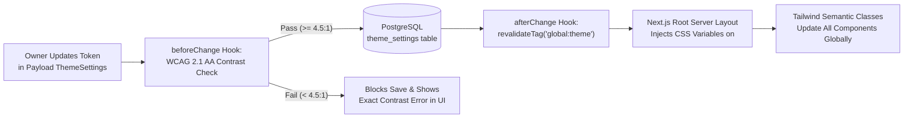

# 18 — Centralized Design Customization & Theming Architecture

**Project:** Bayyora (بيّورا)  
**Author:** Agent 2 (Brand, Design System & Theming Agent)  
**Inputs:** Owner Architecture Mandate (§2.12), `03-BRAND-AND-DESIGN-SYSTEM.md`, `16-CMS-ADMIN-ARCHITECTURE.md`  
**Status:** Complete Design Token & Theme Customization Specification (Planning-Only Mode)

---

## 1. Architectural Goal: Controlled Customization Without Breaking Brand Integrity

Bayyora's theming engine solves a classic agency dilemma:
- **Hardcoded CSS Problem:** If colors, radii, or container widths are hardcoded across dozens of JSX files, even a minor approved palette adjustment (`OD-003`) requires a developer to edit and redeploy code.
- **Unrestricted Page-Builder Problem:** If editors can pick arbitrary hex codes or pixel margins on individual blocks, the website quickly becomes visually inconsistent and fails WCAG accessibility.

**Solution:** A centralized **`ThemeSettings` Global** in Payload CMS (accessible exclusively to the `Owner / Super Admin` role) that manages **approved, semantic design tokens**, validates them against **WCAG 2.1 AA contrast rules**, and injects them at the root `<html>` level as CSS Custom Properties consumed by **Tailwind CSS**.

---

## 2. `ThemeSettings` Global Schema (`src/globals/ThemeSettings.ts`)

| Token Category | Field Key in `ThemeSettings` | Default Seeded Value (Proposed Palette `OD-003`) | CSS Custom Property Emitted | Controlled Admin UI Options |
| :--- | :--- | :--- | :--- | :--- |
| **Palette Preset** | `activePalettePreset` | `'proposed_najd_saffron'` | Sets defaults below | `'proposed_najd_saffron'` (`#12233F` / `#F2A541`), `'reference_terracotta'` (`#12263A` / `#E4572E` from `index.html`), or `'custom_approved'` |
| **Primary Brand Navy** | `colors.primaryNavy` | `#12233F` (*Najd Night*) | `--color-najd-night` | Hex color picker + WCAG contrast preview |
| **Primary Accent** | `colors.accentSaffron` | `#F2A541` (*Saffron Rise*) | `--color-saffron-rise` | Hex color picker + automatic button text contrast resolver (`#12233F` vs `#FFFFFF`) |
| **Secondary Green** | `colors.secondaryOasis` | `#1F7A5C` (*Oasis Green*) | `--color-oasis-green` | Hex color picker |
| **Main Light Canvas** | `colors.canvasSand` | `#F5EFE4` (*Sand*) | `--color-sand` | Hex color picker |
| **Body Text Ink** | `colors.textInk` | `#1A1A1A` (*Ink*) | `--color-ink` | Hex color picker |
| **Card Surface** | `colors.surfaceWhite` | `#FFFFFF` (*White*) | `--color-white` | Hex color picker |
| **Subtle Border / Soft** | `colors.borderSandSoft` | `#EAE0D0` | `--color-sand-soft` | Hex color picker |
| **Typography Scale** | `typography.scalePreset` | `'comfortable_default'` | `--font-size-base`, `--line-height-body` | `'compact'` (`16px`), `'comfortable_default'` (`17px` desktop / `16px` mobile), `'spacious'` (`18px`) |
| **Script Weight Balance** | `typography.balanceLatinWeight` | `true` | `--heading-weight-ar: 700`, `--heading-weight-en: 600` | Toggle: automatically renders English headlines 1 weight lighter than Arabic (`Doc A` §1) |
| **Button Shape** | `components.buttonRadius` | `'pill'` (`9999px`) | `--radius-button` | `'pill'` (`9999px`), `'rounded_lg'` (`14px`), `'rounded_md'` (`10px`) |
| **Card Border Radius** | `components.cardRadius` | `'lg'` (`16px` / `20px`) | `--radius-card`, `--radius-card-lg` | `'md'` (`12px`), `'lg'` (`16px`), `'xl'` (`24px`) |
| **Card Elevation Style** | `components.cardStyle` | `'soft_shadow'` | `--shadow-card`, `--border-card` | `'soft_shadow'`, `'crisp_border'`, `'flat_minimal'` |
| **Container Widths** | `layout.maxContainerWidth` | `'1160px'` | `--wrap-max` | `'1120px'`, `'1160px'` (Default), `'1240px'` |
| **Section Vertical Spacing** | `layout.sectionPaddingPreset` | `'standard_88'` | `--section-py-desktop`, `--section-py-mobile` | `'compact_64'` (`64px`/`48px`), `'standard_88'` (`88px`/`60px`), `'spacious_104'` (`104px`/`72px`) |

---

## 3. End-to-End Token Propagation Pipeline



### 3.1 Tailwind CSS Configuration Binding (`tailwind.config.ts`)
Components never use hardcoded hex values like `bg-[#12233F]` or `bg-[#F5EFE4]`. Instead, `tailwind.config.ts` binds semantic design tokens to the CSS variables injected from `ThemeSettings`:
```typescript
// Conceptual tailwind.config.ts token mapping
colors: {
  brand: {
    navy: 'var(--color-najd-night)',
    'navy-elevated': 'var(--color-najd-elevated)',
    saffron: 'var(--color-saffron-rise)',
    'saffron-text': 'var(--color-on-saffron)', // Automatically resolved to #12233F when Saffron is #F2A541
    oasis: 'var(--color-oasis-green)',
    sand: 'var(--color-sand)',
    'sand-soft': 'var(--color-sand-soft)',
    ink: 'var(--color-ink)',
    muted: 'var(--color-text-muted)',
    surface: 'var(--color-white)',
  }
},
borderRadius: {
  button: 'var(--radius-button)',
  card: 'var(--radius-card)',
  'card-lg': 'var(--radius-card-lg)',
},
maxWidth: {
  wrap: 'var(--wrap-max)',
  narrow: 'var(--wrap-narrow)',
}
```

---

## 4. Automated WCAG 2.1 AA Contrast & Brand Guardrails

To enforce `Doc A` §1's strict rule (*"navy on Sand and white on navy or green pass WCAG AA for text; never put Saffron text on Sand or white; use Saffron as a fill, or on navy only"*):
1. **Automatic Button Foreground Calculation (`--color-on-saffron`):**
   - When `colors.accentSaffron` is saved in `ThemeSettings`, `src/lib/contrast-validator.ts` computes the WCAG relative luminance contrast of `accentSaffron` against `primaryNavy (#12233F)` and `surfaceWhite (#FFFFFF)`.
   - For `#F2A541` (*Saffron Rise*), contrast with `#12233F` is **`7.6 : 1` (AAA Pass)** whereas contrast with `#FFFFFF` is `1.98 : 1` (Fail) — so `--color-on-saffron` is automatically locked to `#12233F`.
   - If the owner selects the `reference_terracotta` preset (`#E4572E`), contrast with `#FFFFFF` is `3.9–4.5 : 1`, adjusting `--color-on-saffron` accordingly.
2. **Pre-Save Contrast Validation Gate:**
   - The `ThemeSettings` `beforeChange` hook verifies that:
     - `textInk` on `canvasSand` $\ge 4.5:1$
     - `primaryNavy` on `canvasSand` $\ge 4.5:1$
     - `surfaceWhite` on `primaryNavy` $\ge 4.5:1$
     - `surfaceWhite` on `secondaryOasis` $\ge 4.5:1$
   - If any combination falls below WCAG AA (`4.5:1`), Payload aborts the save and displays a helpful bilingual error message showing the current ratio and required threshold.
3. **Controlled Block-Level Background Variants:**
   - Inside the 15-Block Page Builder, editors never pick raw colors; they choose from a semantic `sectionBackground` dropdown:
     - `'sand'` (Default warm canvas with `Ink`/`Najd Night` text)
     - `'white'` (Clean white band with `Sand` or `Soft` cards)
     - `'najd_night'` (Deep navy contrast section with `White` text and `Saffron Rise` accents)
   - Each variant automatically pairs the background surface with its pre-validated accessible text, eyebrow, and button tokens.


---

## 6. Extended Design Token & Contrast Enforcement (`25-DESIGN-SYSTEM-SPECIFICATION.md` & `27-ACCESSIBILITY-DESIGN-STANDARDS.md`)

- **Mid-Luminance Dead-Zone Guard:** The `ThemeSettings` `beforeChange` contrast validator rejects any custom or preset accent color whose relative luminance falls in the dead zone ($0.175 < L < 0.240$) where neither `#FFFFFF` nor `#0D2235` achieves `4.5:1` contrast.
- **Accessible Terracotta Preset:** The `reference_terracotta` preset uses `#C7441F` (`4.95:1` with `#FFFFFF`) instead of raw `#E4572E` (`3.68:1`), and form input borders use `--color-border-input: #7A869A` (`>= 3.3:1` on cream/white, satisfying **WCAG 2.2 SC 1.4.11**).
- **Motion Tokens:** Centralized CSS duration (`--duration-micro: 120ms`, `--duration-fast: 180ms`, `--duration-normal: 240ms`) and easing (`--ease-out`, `--ease-in-out`, `--ease-hover`) variables are injected alongside color and spacing tokens (`26-MOTION-AND-ANIMATION-SYSTEM.md`).
