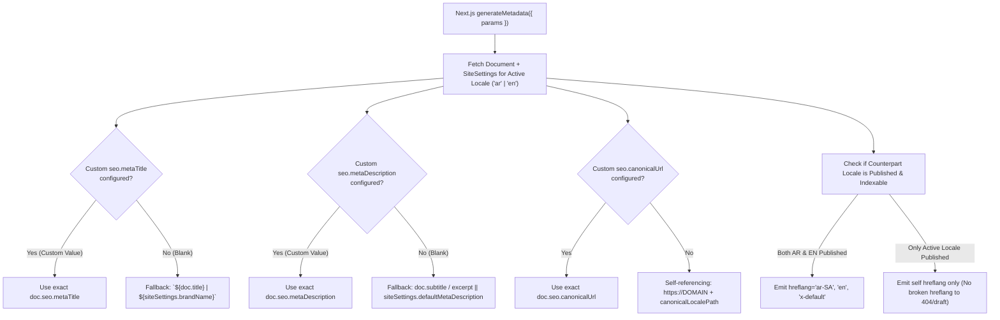

# 19 — Advanced SEO Architecture (100/100 Lighthouse Target) & CMS SEO Maintenance System

**Project:** Bayyora (بيّورا)  
**Author:** Agent 7 (SEO & Local Search Agent)  
**Inputs:** Owner Architecture Mandate (§4.1–§4.7), `10-SEO-AND-LOCAL-SEO-STRATEGY.md`, `17-CONTENT-MODELS-AND-DATABASE-SCHEMA.md`  
**Target:** **Lighthouse SEO: 100/100** across every applicable public, indexable page (`/` and `/en/`)

---

## 1. Engineering for a 100/100 Lighthouse SEO Score

While a 100/100 Lighthouse SEO score does not by itself guarantee #1 Google rankings (which depend on ongoing local authority, content quality, and Google Business Profile signals tracked in Search Console), achieving **100/100 on every public page** proves zero technical SEO defects. Below is how our Next.js + Payload CMS architecture guarantees each Lighthouse SEO audit passes:

| Lighthouse SEO Audit ID | What Lighthouse Checks | Architectural Enforcement in Bayyora (Next.js + Payload CMS) |
| :--- | :--- | :--- |
| **`is-crawlable`** | Page is not blocked from indexing (`noindex`). | Public published pages emit `<meta name="robots" content="index, follow" />` unless `seo.noIndex` is explicitly checked by an SEO Manager. |
| **`document-title`** | Document has a non-empty `<title>` element. | `generateMetadata()` always resolves `doc.seo.metaTitle || "${doc.title} | ${siteSettings.brandName}"`. |
| **`meta-description`** | Document has a `<meta name="description">`. | `generateMetadata()` resolves `doc.seo.metaDescription || doc.subtitle || siteSettings.defaultMetaDescription` (mandatory pre-publish hook check). |
| **`http-status-code`** | Page returns a successful HTTP `200` status code. | Missing slugs invoke Next.js `notFound()` returning a proper HTTP `404` status (never a soft-404 `200`). Changed slugs issue HTTP `301` redirects. |
| **`link-text`** | Links have descriptive text (not generic `"click here"` / `"اضغط هنا"`). | All CTA buttons and internal links use descriptive localized labels (`اطلب تحليل مجاني لمحلّك`, `شوف كل الخدمات`) or explicit `aria-label` attributes on icon links. |
| **`crawlable-anchors`** | `<a>` tags use valid `href` attributes. | All navigation links use Next.js `<Link href="...">`; interactive triggers without URLs use semantic `<button type="button">` (never `<a href="#">`). |
| **`image-alt`** | Every `` element has an `alt` attribute. | Payload `Media` collection enforces required localized `alt` (`ar` and `en`) on upload; purely decorative SVGs (Rising Line arrow) set `aria-hidden="true"`. |
| **`hreflang`** | Document has valid `hreflang` links (`ar-SA`, `en`, `x-default`). | `generateMetadata()` outputs bidirectional `alternates.languages` only when the target translation is also `published` and indexable. |
| **`canonical`** | Document has a valid `rel="canonical"` URL. | `generateMetadata()` outputs `doc.seo.canonicalUrl || "https://${DOMAIN}${localePath}"`. |
| **`robots-txt`** | `robots.txt` is valid and crawlable. | `src/app/robots.ts` serves a clean, syntactically valid `robots.txt` referencing `https://<DOMAIN>/sitemap.xml`. |
| **`tap-targets` & `font-size`** | Mobile tap targets $\ge 48\times48\text{px}$ and legible base font $\ge 16\text{px}$. | Design system enforces `min-h-[48px]` on all buttons/inputs and `16px` (`1rem`) minimum mobile body font size. |

---

## 2. Next.js `generateMetadata` Resolution Hierarchy (§4.1 & §4.2)

For every route (`Pages`, `Services`, `Packages`, `Projects`, `Cities`, `Posts`), `src/seo/generate-page-metadata.ts` implements a deterministic priority waterfall that **never overwrites a custom value configured by an administrator**:

- **Open Graph & Twitter/X Cards:**
  - `openGraph.title`: `doc.seo.ogTitle || resolvedTitle`
  - `openGraph.description`: `doc.seo.ogDescription || resolvedDescription`
  - `openGraph.images`: `doc.seo.ogImage || doc.heroImage || siteSettings.defaultOgImage` (automatically resized to `1200x630` WebP/JPEG via Payload `Media` image sizes)
  - `openGraph.locale`: `'ar_SA'` on `/` routes, `'en_US'` on `/en/` routes (`alternateLocale` set when counterpart is published)
  - `twitter.card`: `'summary_large_image'`

---

## 3. Truthful Structured Data (`Schema.org` JSON-LD) Architecture (§4.4)

All JSON-LD blocks are generated server-side by `src/seo/json-ld.ts` and injected via `<script type="application/ld+json">`.

### 3.1 Strict Truthfulness & Google Policy Rules
1. **Zero Fabricated Fields:** The JSON-LD builder **never** outputs `aggregateRating`, `review`, `priceRange`, `offers.price`, `postalAddress`, `telephone`, or `openingHoursSpecification` unless those exact fields are verified, populated in `SiteSettings` / collection records, and **visibly displayed to users on the page**.
2. **Schema Mapping by Page Type:**
   - **Global / Homepage (`/` & `/en`):** `Organization` + `LocalBusiness` (`ProfessionalService`) with verified `name` (`بيّورا | Bayyora`), `slogan` (`خطوة لفوق | One step up`), `url`, `logo`, `areaServed` (referencing published `Cities`: Al Ahsa, Hofuf, Mubarraz, Dammam, Khobar), and `sameAs` (populated only with active social URLs from `SiteSettings`). Once `OD-011` (WhatsApp/Phone, Email, Hours) is populated in `SiteSettings`, `telephone`, `email`, and `openingHoursSpecification` are included automatically.
   - **Individual Service Pages (`/services/[slug]`):** `Service` schema (`name`, `description`, `provider` referencing `#organization`, `areaServed`, `serviceType`) + `BreadcrumbList` (`Home → Services → [Service Name]`) + `FAQPage` (matching the visible 3–4 service FAQs on that page).
   - **City Pages (`/city/[slug]`):** Localized `ProfessionalService` / `Service` schema with `areaServed` focused on that specific city (`Al Ahsa`, `Hofuf`, `Mubarraz`, `Dammam`, `Khobar`) + `BreadcrumbList`.
   - **FAQ Page (`/faq`):** `FAQPage` schema generated strictly from the visible published `Faqs` rendered on `/faq` + `BreadcrumbList`.
   - **Blog Articles (`/blog/[slug]`):** `Article` / `BlogPosting` schema (`headline`, `description`, `image`, `datePublished`, `dateModified`, `author`, `publisher`, `inLanguage`: `'ar-SA'` or `'en'`) + `BreadcrumbList`.

---

## 4. Built-In SEO Admin Tools in Payload CMS (§4.6)

Inside the Payload Admin Dashboard, every document with `seoFields` renders a custom **SEO Assistant Panel (`SeoAssistantField.tsx`)** alongside a dedicated **SEO & Redirects Sidebar Group**:

| SEO Admin Tool | How It Works in the Admin Dashboard |
| :--- | :--- |
| **1. Live Character Counters & Pixel Width Bar** | Displays live character count and color-coded status bar for `metaTitle` (Green: `30–60` chars; Amber: `< 30`; Red: `> 60`) and `metaDescription` (Green: `70–155` chars; Red: `> 155`), plus a live Google Mobile SERP snippet preview in RTL (`ar`) or LTR (`en`). |
| **2. Metadata Completeness Score Badge (`0–100%`)** | Displayed on both the document edit view and collection list view (`SEO: 100% 🟢`). Checks: (1) Title present & $\le 60$ chars, (2) Description present & $\le 155$ chars, (3) Single H1 populated, (4) Hero/OG image has localized `alt` text, (5) Focus keyword present in H1 & Title. |
| **3. Missing Alt Text & Missing Canonical Warnings** | Scans all images referenced inside the page's blocks/fields and flags an immediate warning banner if any image lacks `alt` text in the active locale, or if a custom canonical URL is malformed. |
| **4. Missing Translation Warning (`AR` vs `EN`)** | Compares the `ar` and `en` locale tables for the current document and displays a clear warning (`⚠️ English metaDescription is missing`) so untranslated metadata is never overlooked. |
| **5. Sitemap Inclusion & `noIndex` Status Pill** | Shows an unmistakable pill in the sidebar: **`🟢 Indexed & Included in /sitemap.xml`** when `_status === 'published' && !seo.noIndex`, or **`🟡 Excluded from Sitemap (Draft / Noindex)`**. |
| **6. Structured Data Preview & Validator** | Shows the exact JSON-LD object that will be rendered on the page and validates that all required Schema.org properties (`@context`, `@type`, `name`, `url`) are present. |
| **7. Internal Link Suggestions Assistant** | When editing a Service, City, or Blog Post, suggests relevant published Services, Cities, and `/free-audit` links that have not yet been linked in the body copy. |
| **8. Automated & Manual 301 Redirect Manager** | • **Auto-Creation:** Changing the `slug` of any published document automatically creates a `301` redirect in the `Redirects` collection (`fromPath -> toPath`) for both `/` and `/en/`. • **Loop & Chain Detection:** Validates on save that `fromPath !== toPath` and resolves redirect chains (`A -> B -> C` flattened to `A -> C`). |
| **9. Broken Link Scanner & Admin Report** | Background job / on-demand admin button that crawls internal links across all published blocks and rich-text fields, flagging any link pointing to an unpublished, deleted, or `404` slug in the `BrokenLinksReport` admin view. |

---

## 5. Arabic & Local SEO Anti-Doorway Governance (§4.5)

To rank sustainably in Saudi Arabia across **Al Ahsa (`الأحساء`)**, **Hofuf (`الهفوف`)**, **Mubarraz (`المبرّز`)**, **Dammam (`الدمام`)**, and **Khobar (`الخبر`)** (and future cities added via the CMS):
1. **Anti-Doorway Uniqueness Check:** When creating or editing a `Cities` record, a Payload `beforeChange` validation hook calculates token similarity (Jaccard/cosine shingle similarity) between the city's `localIntro` / body copy and existing cities. If similarity exceeds `40%`, the CMS warns the editor to write fresh city-specific content referencing real local context (e.g., Qaisariya Souq in Al Ahsa, cafés and corniche retail in Khobar, restaurants like Dawair in Hofuf).
2. **Semantic Heading Hierarchy Lock:** Page Builder blocks are coded so the page Hero renders the **only `<h1>`** on the page; subsequent blocks render `<h2>` for section titles and `<h3>` for card titles — guaranteeing strict `H1 → H2 → H3` hierarchy even when editors reorder blocks.

