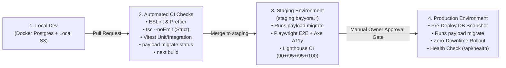

# 20 — Security, Performance, Caching & DevOps Architecture

**Project:** Bayyora (بيّورا)  
**Author:** Agent 8 (Performance, Security & DevOps Agent)  
**Inputs:** Owner Architecture Mandate (§5, §6, §10), `08-NEXTJS-TECHNICAL-ARCHITECTURE.md`, `17-CONTENT-MODELS-AND-DATABASE-SCHEMA.md`  
**Status:** Complete Security, Performance & Operations Specification (Planning-Only Mode)

---

## 1. Performance & Core Web Vitals Architecture (§5)

### 1.1 Quality Targets (Verified via Lighthouse CI)
- **Mobile Lighthouse Performance:** **$90+$** (`LCP < 2.0s`, `CLS < 0.05`, `INP < 150ms`, `TTFB < 400ms`)
- **Lighthouse Accessibility:** **$95+$**
- **Lighthouse Best Practices:** **$95+$**
- **Lighthouse SEO:** **$100/100$**

### 1.2 Architectural Pillars Guaranteeing 90+ Mobile Performance
1. **React Server Components (RSC) by Default:**
   - All 15 Page Builder blocks, navigation bars, service/package cards, FAQs (using native HTML `

`), and JSON-LD generators execute exclusively on the server, shipping **0 KB of component JavaScript** for static content.
   - Total first-load client JS budget is capped at **`< 85 KB` gzipped** (enforced in CI via Next.js bundle analyzer).
2. **Tag-Based ISR & On-Demand Revalidation (`revalidateTag`):**
   - Public pages are statically cached after initial render (`unstable_cache` + Next.js Route Cache).
   - Visitors in Al Ahsa, Dammam, and Khobar receive pre-rendered HTML from the nearest Middle East edge PoP in `< 80ms`, while CMS edits invalidate only the affected cache tags (`revalidateTag('collection:services')`, `revalidatePath('/services/brand-identity')`) within `< 500ms` of clicking Publish.
3. **`next/image` & `sharp` Media Pipeline:**
   - Configured in `next.config.mjs` with `formats: ['image/avif', 'image/webp']` and tailored `deviceSizes: [390, 430, 640, 768, 1024, 1280, 1536]`.
   - Above-the-fold Hero visuals set `priority={true}` and `fetchPriority="high"`; all below-the-fold images use native `loading="lazy"` and explicit `width`/`height` dimensions from Payload `Media` metadata to guarantee **`CLS = 0.00`**.
4. **`next/font/local` Self-Hosted `Readex Pro` Optimization:**
   - Loads `ReadexPro-Variable.woff2` (or subset weights `400, 500, 600, 700` for `arabic` and `latin`) from local project storage via `next/font/local` with `display: 'swap'`, `preload: true`, and automatic fallback font metric overrides (`adjustFontFallback: 'Arial'`) to eliminate font-swap layout shifts.
5. **Strict Third-Party Script Deferral:**
   - GoHighLevel form embeds are **replaced on `/free-audit` and `/contact` by native Next.js Server Action forms** (`0 KB` third-party form iframe overhead!).
   - The GoHighLevel Visit Booking Calendar on `/contact` is lazy-loaded via `IntersectionObserver` only when the user scrolls near the calendar section or clicks *"Select a visit time"*.
   - GTM, GA4, Meta Pixel, and Snapchat Pixel load after hydration (`strategy="lazyOnload"`) gated by the user's Saudi PDPL consent state.

---

## 2. Admin Security & Access Control Architecture (§6)

### 2.1 Authentication & Session Security
- **Password & Credential Hardening:** Payload CMS authentication configured with strong password complexity validation (`min 12 chars`), PBKDF2/Argon2 hashing, and built-in account lockout (`maxLoginAttempts: 5`, `lockTime: 15 * 60 * 1000` [15 minutes]).
- **Secure Cookies & CSRF:** Admin session tokens are stored in `HttpOnly`, `Secure`, `SameSite=Lax` cookies with short expiration (`7200s` / 2 hours) and sliding refresh, plus strict CSRF origin verification on all mutating endpoints and Server Actions.
- **Protected Administrative Routes:** `/admin/*` and mutating `/api/*` routes are protected by both Next.js Middleware and Payload collection-level access control functions.

### 2.2 Server-Side RBAC Enforcement (6 Roles)
Every Payload collection (`Pages`, `Services`, `Packages`, `Projects`, `Cities`, `Posts`, `Faqs`, `Media`, `Redirects`, `Users`, `AuditLogs`) and Global (`SiteSettings`, `HeaderNav`, `FooterNav`, `ThemeSettings`) enforces server-side access functions (`access: { create, read, update, delete, admin }`):
- **Critical Rule for Payload Local API:** Whenever calling `payload.find()` or `payload.update()` on behalf of an authenticated user, **`overrideAccess: false`** and `user: req.user` must be passed so Payload never bypasses RBAC permissions on the server.
- **Role Capabilities Summary:**
  1. `owner` (*Owner / Super Admin*): Unrestricted control over all settings, `ThemeSettings`, `publicPricingEnabled`, legal pages, users, and backups.
  2. `admin` (*Administrator*): Full content, SEO, user management (for editors/translators), and legal page publishing; cannot change `owner` accounts or core pricing policy flags.
  3. `editor` (*Content Editor*): Create/edit/publish non-legal pages, services, packages, projects, cities, blog posts, FAQs, and media.
  4. `seo_manager` (*SEO Manager*): Edit `seoFields` across all collections, manage `Redirects`, inspect `BrokenLinksReport`, and edit image `alt` texts.
  5. `arabic_translator` (*Arabic Translator / Native Saudi Reviewer*): Edit `ar` locale fields, update `translationStatus` (`in_review` $\rightarrow$ `approved`), and access Live Preview.
  6. `viewer` (*Viewer / Reviewer*): Read-only access to the Admin Dashboard and Draft Live Preview links.

### 2.3 Rate Limiting, Input Validation & File Upload Security
1. **Rate Limiting:** Applied via middleware/Server Action wrapper (backed by Redis/Upstash or LRU in-memory store):
   - `/api/users/login`: Max `5` requests / 15 mins per IP.
   - `submitAuditAction` & `submitContactAction`: Max `5` submissions / 10 mins per IP + honeypot field check to block automated bots without frustrating shop owners.
2. **File Upload Validation (`Media` Collection):**
   - Strictly restricted to `mimeTypes: ['image/webp', 'image/png', 'image/jpeg', 'image/avif', 'image/svg+xml', 'application/pdf']`.
   - Maximum upload size: `10 MB` for images/PDFs.
   - **SVG Sanitization Hook:** Only `Owner` and `Administrator` roles may upload `.svg` files (such as logo variants), and a `beforeOperation` hook sanitizes SVG XML via `isomorphic-dompurify` to strip any embedded `<script>`, `onload`, or external `<use>` payloads.
3. **Environment Variable Validation (`src/env.ts`):**
   - Validated at application startup using `@t3-oss/env-nextjs` + `zod`. If `DATABASE_URI`, `PAYLOAD_SECRET`, `NEXT_PUBLIC_SITE_URL`, or `S3_BUCKET` is missing or malformed, the build/boot fails immediately with a clear diagnostic error.

---

## 3. CI/CD Pipeline, Hosting Architecture & Deployment (§10)

### 3.1 Hosting Architecture Evaluation (Dynamic CMS + Database + Object Storage)
Because Bayyora runs a dynamic Next.js App Router + Payload CMS application with on-demand cache revalidation and Server Actions, ordinary static-only hosting is insufficient. Below are the two recommended production hosting topologies optimized for low latency in **Saudi Arabia (Riyadh/Dammam/Jeddah)**:

| Component | **Topology A: Managed Container Stack (Recommended for Cost & Full Node.js Runtime)** | **Topology B: Serverless Edge Stack** |
| :--- | :--- | :--- |
| **Next.js + Payload Compute** | **Railway Pro** or **AWS ECS Fargate (`me-central-1` UAE / `me-south-1` Bahrain / `eu-central-1`)** running persistent Node.js 22 container (zero cold starts on `/admin` or `sharp` image resizing). | **Vercel Pro** (Middle East / Europe edge network + Serverless Functions). |
| **PostgreSQL 16 Database** | **Managed PostgreSQL** (Neon, Supabase, or Railway/AWS RDS) in the same region as compute (`< 2ms` DB latency) with continuous WAL PITR enabled. | **Neon Serverless Postgres** or **Supabase Postgres** with connection pooling (`PgBouncer`). |
| **Media Object Storage** | **Cloudflare R2** (S3-compatible, `$0` egress fees, served via Cloudflare Saudi Arabia edge PoPs in Dammam, Riyadh, and Jeddah). | **Cloudflare R2** or **AWS S3** (`@payloadcms/storage-s3`). |
| **Edge CDN & WAF** | **Cloudflare Pro/Free CDN + WAF** in front of the domain (`OD-001`). | Vercel Edge Network / Cloudflare. |

### 3.2 Three-Environment Promotion & CI/CD Pipeline (`GitHub Actions`)

---

## 4. Database Migrations, Backups, Restore Drills & Rollback Strategy

1. **Deterministic Database Migrations (`src/migrations/`):**
   - In local development, schema edits are captured into timestamped Drizzle migration files via `pnpm payload migrate:create`.
   - In Staging and Production (`NODE_ENV === 'production'`), automatic schema pushing (`push: false`) is **strictly disabled**. The CI/CD deployment pipeline runs `pnpm payload migrate` against PostgreSQL after taking a pre-deploy snapshot.
2. **Automated Backup Architecture (3-2-1 Rule):**
   - **Continuous Point-in-Time Recovery (PITR):** Managed PostgreSQL WAL archiving retains continuous 7-to-30-day point-in-time recovery down to the exact second.
   - **Daily Encrypted Logical Backups:** Automated daily `pg_dump --format=custom` cron job uploads AES-256 encrypted database snapshots to an isolated S3/R2 backup bucket (`retention: 30 daily, 12 monthly`).
   - **Media Bucket Versioning:** S3/Cloudflare R2 object versioning enabled on the media bucket so overwritten or deleted files can be restored.
3. **Restore Testing & Rollback Procedures:**
   - **Application Rollback (< 60 Seconds):** Instant container image / deployment rollback to the previous immutable build artifact if `/api/health` or post-deploy smoke tests fail.
   - **Content Rollback (< 5 Seconds):** Native 1-click document/global version restore inside Payload Admin (`/admin`).
   - **Database Disaster Recovery Drill:** Automated monthly restore verification script that loads the latest nightly `pg_dump` into an ephemeral test database and verifies table counts and integrity.

---

## 5. Error Monitoring, Structured Logging & Uptime Alerting

- **Structured Application Logging:** Uses **`pino`** (configured natively in Payload CMS and Next.js Server Actions) emitting structured JSON logs (`level`, `requestId`, `route`, `locale`, `durationMs`, `errorCode`) with automatic redaction of PII (`whatsapp`, `phone`, `email`, `authorization` headers).
- **Error Tracking:** **Sentry (`@sentry/nextjs`)** (or OpenTelemetry collector) capturing unhandled server exceptions, failed GoHighLevel webhook retries, and client hydration errors.
- **Uptime & SSL Monitoring:** `/api/health` endpoint verifies both Next.js runtime responsiveness and a `SELECT 1` PostgreSQL connection check every 60 seconds, alerting the Owner/Admin via WhatsApp/Email if latency exceeds thresholds or status != `200 OK`.

