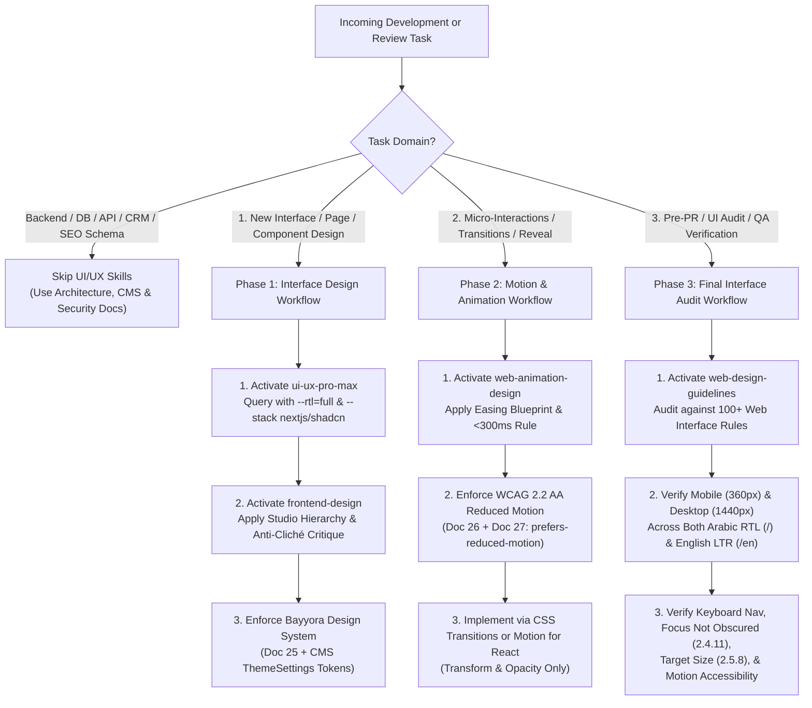

# 24 — UI/UX, Frontend Design & Motion Skills Architecture & Routing Workflow

**Project:** Bayyora (بيّورا) — Saudi Digital Marketing & Creative Agency  
**Tagline:** خطوة لفوق — *One step up*  
**Document Version:** 1.0  
**Status:** Active Specification (Planning & Workspace Skill Setup Phase — Implementation Gate Active)  
**Cross-References:** `03-BRAND-AND-DESIGN-SYSTEM.md`, `04-HTML-REFERENCE-DESIGN-AUDIT.md`, `06-UX-AND-USER-JOURNEYS.md`, `08-NEXTJS-TECHNICAL-ARCHITECTURE.md`, `18-DESIGN-CUSTOMIZATION-AND-THEMING.md`, `25-DESIGN-SYSTEM-SPECIFICATION.md`, `26-MOTION-AND-ANIMATION-SYSTEM.md`, `27-ACCESSIBILITY-DESIGN-STANDARDS.md`, `28-SKILL-INSTALLATION-AND-INVENTORY.md`

---

## 1. Purpose & Architectural Scope

To ensure Bayyora's Next.js App Router (`ar` RTL default / `en` LTR secondary) website looks like an intentional, high-trust Saudi agency product—and never a generic, AI-generated SaaS template—four specialized Agent Skills have been verified, adapted for workspace safety, and installed at the workspace level under `.agents/skills/`:

1. **`ui-ux-pro-max`** (`.agents/skills/ui-ux-pro-max/SKILL.md`) — Searchable UI/UX design intelligence, RTL compatibility rules (`--rtl=full`), component ergonomics, and stack-specific Next.js/React/Tailwind/shadcn guidelines.
2. **`frontend-design`** (`.agents/skills/frontend-design/SKILL.md`) — Studio-grade visual direction, typographic discipline, anti-cliché self-critique, and intentional layout composition.
3. **`web-design-guidelines`** (`.agents/skills/web-design-guidelines/SKILL.md`) — 100+ Web Interface Guidelines for auditing semantic HTML, keyboard navigation, focus states, forms, RTL/i18n, and Core Web Vitals.
4. **`web-animation-design`** (`.agents/skills/web-animation-design/SKILL.md`) — Purposeful motion engineering based on Emil Kowalski's web animation methodology (easing blueprint, `< 300ms` UI timing, GPU compositor discipline, `prefers-reduced-motion`, and touch-device hover isolation).

---

## 2. Bayyora Design Identity & Non-Negotiable Guardrails

Every skill invocation is subordinate to Bayyora's confirmed business identity and design rules (`00-PROJECT-SOURCE-AUDIT.md`, `03-BRAND-AND-DESIGN-SYSTEM.md`, `04-HTML-REFERENCE-DESIGN-AUDIT.md`):

### 2.1 Core Brand & Audience Anchors
- **Brand:** Bayyora — بيّورا (`خطوة لفوق` / *One step up*)
- **Primary Audience:** Non-technical local shop, restaurant, café, pharmacy, clinic, salon, and retail owners across **Al Ahsa (Hofuf, Mubarraz), Dammam, and Khobar**.
- **Design Personality:** Clean, friendly, warm, structured, trustworthy, Arabic-first (`dir="rtl"`), mobile-first (`360px–430px` primary viewport), and conversion-oriented (WhatsApp + 48-hour Free Mini Audit).
- **Visual Reference Priority:** Preserve the strongest structural patterns from the HTML design reference (`04-HTML-REFERENCE-DESIGN-AUDIT.md`: warm sand/cream canvas `#F7F3EB` / `#F5EFE4`, deep navy authority sections `#0D2235` / `#12233F`, Saudi palm/oasis teal `#136F63` / `#1F7A5C`, tangible Hero Before/After transformation card, 3x3 service grid, 4-step process strip, elevated `Numow` package card, and seasonal campaign tabs) while fixing its documented accessibility, contrast, and hardcoding weaknesses.

### 2.2 Strict Anti-AI-Aesthetic Prohibitions
When designing or reviewing any Bayyora page or component, agents MUST REJECT:
1. **Unnecessary Gradients & Neon Glows:** No multi-stop mesh gradients, glowing cyber borders, or SaaS purple/blue gradient text.
2. **Excessive Glassmorphism:** Reserve subtle backdrop blur (`backdrop-blur-md`) strictly for the sticky top navigation bar (`72px–74px`). Never use glassmorphic cards on content sections.
3. **Decorative Floating Blobs & Abstract 3D:** No floating blurred circles, meaningless 3D shapes, or decorative background noise.
4. **Excessive Border Radius:** Maximum card radius is `16px` (`rounded-2xl`), container panels `20px–24px`, and pills (`9999px`) strictly for buttons/badges.
5. **Heavy Parallax & Scroll-Jacking:** Never hijack native scroll velocity, pin marketing sections unnecessarily, or add continuous floating idle animations (`animation: float infinite`).
6. **Autoplay Background Videos:** Strictly forbidden (protects mobile data and LCP on Saudi 4G/5G networks and respects `prefers-reduced-motion`).
7. **Repetitive Generic Bento Grids:** Use clear, scannable editorial grids (3x3 for the 9 services, 3-column comparison for monthly packages, 2-column for starter bundles) where layout structure encodes content hierarchy.
8. **Excessively Large Display Headings & Wasted Whitespace:** Keep headings within the calibrated `clamp()` fluid scale (`25-DESIGN-SYSTEM-SPECIFICATION.md`) so Arabic headlines never clip ascenders/descenders or push above-the-fold CTAs below the mobile viewport.

---

## 3. Deterministic Skill Routing Strategy

Skills must be activated selectively based on the active task phase. **Never invoke UI/UX or animation skills for pure backend tasks** (such as PostgreSQL migrations, Drizzle schema generation, CRM webhook handlers, or unit test runners).



### 3.1 Workflow A: New Interface or Component Design
1. **Invoke `ui-ux-pro-max`**:
   - Run targeted local queries against `.agents/skills/ui-ux-pro-max/scripts/search.py` using `py -3` (Python 3.15 launcher on Windows), `--rtl=full` for layout/style patterns, and `--stack nextjs` or `--stack html-tailwind` for implementation patterns:
     ```powershell
     py -3 ".agents/skills/ui-ux-pro-max/scripts/search.py" "Conversion Trust" --domain landing
     py -3 ".agents/skills/ui-ux-pro-max/scripts/search.py" "focus not obscured" --domain ux
     ```
   - **Bayyora Override Rule:** Never run `--design-system --persist` to overwrite Bayyora's established brand tokens. `25-DESIGN-SYSTEM-SPECIFICATION.md` and the Payload CMS `ThemeSettings` Global are the canonical source of truth.
2. **Invoke `frontend-design`**:
   - Verify that every visual device (borders, numbering `01–04` on the 4-step process, `نموذج توضيحي` sample badge, `الأكثر طلباً` most-popular pill) encodes real business meaning from `00-PROJECT-SOURCE-AUDIT.md`.
   - Ensure one focal element per viewport section carries visual weight while surrounding elements remain calm and legible.
3. **Bind to `25-DESIGN-SYSTEM-SPECIFICATION.md`**:
   - Use semantic CSS custom properties (`var(--color-*)`, `var(--radius-*)`, `var(--space-*)`) mapped to Tailwind utility classes and CSS logical properties (`ms-*`, `me-*`, `ps-*`, `pe-*`, `text-start`).

### 3.2 Workflow B: Animation & Micro-Interaction Implementation
1. **Invoke `web-animation-design`**:
   - Select the correct easing curve from the Easing Blueprint (`ease-out` for enter/exit, `ease-in-out` for on-screen morph/slider movement, `ease` for color/hover transitions).
   - Keep all interactive UI transitions (`dropdown`, `accordion`, `drawer`, `tabs`, `modal`) under `300ms`.
2. **Enforce Reduced Motion & Touch Guardrails (`26-MOTION-AND-ANIMATION-SYSTEM.md` & `27-ACCESSIBILITY-DESIGN-STANDARDS.md`)**:
   - Wrap all CSS hover transforms in `@media (hover: hover) and (pointer: fine)` (or Tailwind's hover media query config) so touch taps on mobile never trigger sticky hover states.
   - Respect `prefers-reduced-motion: reduce` in CSS and `useReducedMotion()` in `motion/react` Client Components.

### 3.3 Workflow C: Final Interface Review & Pre-Release QA
1. **Invoke `web-design-guidelines`**:
   - Audit every component against `.agents/skills/web-design-guidelines/references/web-interface-guidelines.md`.
2. **Execute the 6-Point Bayyora UI Sign-Off**:
   - **Mobile & Desktop:** Zero horizontal overflow at `360px`, `390px`, `768px`, `1024px`, and `1440px`.
   - **RTL & LTR:** Verify Arabic (`dir="rtl"`, `lang="ar"`) and English (`dir="ltr"`, `lang="en"`) mirror directional icons (`ArrowLeft`/`ArrowRight`), drawers, and breadcrumbs while keeping phone numbers (`+966...`) and URLs `dir="ltr"`.
   - **Keyboard Navigation:** Full `Tab` / `Shift+Tab` / `Escape` / `Arrow` key operability with zero focus traps and `scroll-padding-top` preventing sticky-header focus obscuration (WCAG 2.2 SC 2.4.11).
   - **Motion Accessibility:** Verify instant state changes without spatial motion when `prefers-reduced-motion: reduce` is enabled.
   - **CMS Operability:** Verify zero hardcoded marketing strings, links, or badge labels inside TSX components.

---

## 4. Resolution of Upstream Skill Conflicts

During pre-installation inspection (`28-SKILL-INSTALLATION-AND-INVENTORY.md`), four potential conflicts between upstream skill defaults and Bayyora's requirements were identified and resolved:

| Conflict ID | Upstream Skill & Rule | Bayyora Requirement | Mandatory Resolution Rule |
| :--- | :--- | :--- | :--- |
| **SK-CONF-01** | `frontend-design` (`SKILL.md:285`) flags warm cream (`#F4F1EA`) + terracotta (`#D97757`) as an AI default when unrequested, though line 291 states *"Where the brief pins down a visual direction, follow it exactly."* | Bayyora's owner-supplied HTML reference (`bayyora-homepage.html`) explicitly uses Warm Sand/Cream (`#F7F3EB` / `#F5EFE4`) with Deep Navy (`#0D2235` / `#12233F`), Saudi Palm Teal (`#136F63` / `#1F7A5C`), and Saffron/Terracotta (`#F2A541` / accessible `#C7441F`). | Follow Bayyora's explicit palette (`25-DESIGN-SYSTEM-SPECIFICATION.md`) while applying `frontend-design`'s layout restraint, typographic hierarchy, and anti-SaaS-cliché rules. |
| **SK-CONF-02** | `ui-ux-pro-max` (`SKILL.md:46`) uses `${CLAUDE_PLUGIN_ROOT}/.claude/skills/...` and includes a `--domain gsap` preset table. | Antigravity workspace skills live in `.agents/skills/ui-ux-pro-max/`; Bayyora uses CSS transitions + **Motion for React (`motion/react`)** as primary animation tools (`26-MOTION-AND-ANIMATION-SYSTEM.md`). | Invoke `search.py` via `.agents/skills/ui-ux-pro-max/scripts/search.py`; ignore `--domain gsap` unless a future complex timeline is explicitly approved by the Owner. |
| **SK-CONF-03** | `web-animation-design` (`SKILL.md:10–16`) instructs the agent to reply only with a canned 1-sentence greeting when first invoked without a question, and imports legacy `"framer-motion"` (`SKILL.md:276`). | Antigravity agents execute multi-step tasks autonomously and use React 19 + Next.js 15 (`motion/react`). | Ignore the conversational greeting gate during task execution; translate all `framer-motion` imports to `motion/react` (`import { motion, AnimatePresence, useReducedMotion } from 'motion/react'`). |
| **SK-CONF-04** | `web-design-guidelines` (`SKILL.md:25`) fetches `command.md` live from `raw.githubusercontent.com` on every review. | Live fetching a mutable external Markdown file introduces network dependency and indirect prompt-injection risk (OWASP AISVS). | Use the verified, immutable local snapshot vendored at `.agents/skills/web-design-guidelines/references/web-interface-guidelines.md` by default. |
